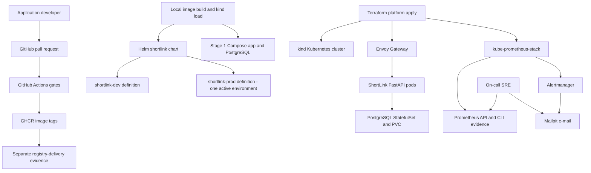

# ShipIt DevOps platform

ShipIt is a six-week backend/DevOps project where one fresher builds a small FastAPI ShortLink API and its local delivery platform. No student-built frontend, custom dashboard/panel/visualization, or public/cloud deployment exercise is allowed, including optional/bonus work.

This is a specifications-only repository of exactly 15 Markdown documents. [Document 06](docs/06-tech-stack-and-setup.md#local-operation-contract) defines commands students MUST implement: `make local-start` defaults to stage 1 Compose (app + PostgreSQL), `make local-start STAGE=kind PROFILE=lite ENV=prod` selects stage 2 local kind, `make local-demo STAGE=compose` demonstrates the API, and `make local-stop STAGE=compose` preserves data. After initial downloads, both stages work without external egress, a cloud account, public hostname, or API key. kind uses locally built images and `kind load docker-image`; GitHub/GHCR are separate CI exercises, not startup dependencies.

## Quick facts

| Item | Value |
|---|---|
| Track | DevOps / Cloud Native |
| Difficulty | ★★★★☆ Upper-intermediate |
| Duration | 6 weeks, about 180 hours |
| Target job roles | DevOps Engineer, Cloud Engineer, Site Reliability Engineer, Platform Engineer, Build and Release Engineer |
| Key skills | Python/FastAPI APIs, Linux, Bash, Docker, GitHub Actions, Kubernetes, Helm, Terraform, Prometheus HTTP API/CLI evidence, alerting, runbooks |
| Prerequisites | Basic Python, basic SQL, Git basics, HTTP basics |
| Minimum hardware | 8 GB RAM, 4 cores, 20 GB free disk; one-node kind lite, one active app environment |
| Recommended hardware | 16 GB RAM, 4 or more cores, 30 GB free disk; standard profile |
| WSL2 memory/swap | 8 GB host: 4 GB/4 GB; 16 GB host: 8 GB/4 GB |
| Student repository name | `shipit` |

## What you will build

- A FastAPI ShortLink service with `POST /api/v1/links`, `GET /{code}`, `/healthz`, `/readyz`, and `/metrics`.
- A secure Docker image below 200 MB and a Docker Compose development stack.
- Operational Bash scripts for bootstrap, smoke tests, PostgreSQL backup, and restore.
- GitHub Actions PR gates for lint, tests, coverage, scans, Helm, Kubernetes schemas, and Terraform.
- A local kind 0.33.x cluster with dev/prod namespace definitions, exercised sequentially in lite.
- A Helm 4.x chart named `shortlink` with dev and prod values.
- Terraform 1.16.x that creates kind and installs Envoy Gateway and kube-prometheus-stack.
- Prometheus HTTP API/CLI queries, saved metrics/alert JSON, Mailpit alert e-mail, and runbooks. Built-in Grafana is optional operations tooling only, not an implementation deliverable.
- Reliability evidence for rolling update, rollback, and pod self-healing drills.
- Interview notes that map kind to EKS, GHCR to ECR, PVC to EBS, Gateway to a load balancer, alert e-mail to SNS or SES, and local Terraform state to S3 remote state.

## Architecture at a glance

## How to read this specification

1. Read the overview, users, functional requirements, and non-functional requirements first.
2. Read the architecture, data model, and platform specification before you create implementation folders.
3. Read setup, DevOps, milestones, testing, rubric, interview, and glossary documents before the first Friday demo.
4. `MUST` means mandatory for grading. `SHOULD` means recommended after Must scope. `MAY` means optional stretch work.
5. IDs keep work traceable: user stories use `US-NN`, functional requirements use `FR-AREA-NN`, business rules use `BR-NN`, non-functional requirements use `NFR-CAT-NN`, and test cases use `TC-TYPE-NNN`.

## Document index

| Document | Purpose |
|---|---|
| [01 Project overview](docs/01-project-overview.md) | Explains the problem, vision, scope, constraints, and success criteria. |
| [02 Users and roles](docs/02-users-and-roles.md) | Defines roles, personas, permissions, journeys, and user stories. |
| [03 Functional requirements](docs/03-functional-requirements.md) | Defines FRs, business rules, state machines, validation, and errors. |
| [04 Non-functional requirements](docs/04-non-functional-requirements.md) | Defines measurable quality, security, reliability, and portability targets. |
| [05 System architecture](docs/05-system-architecture.md) | Shows architecture diagrams, deployment view, repository tree, and ADR list. |
| [06 Tech stack and setup](docs/06-tech-stack-and-setup.md) | Pins versions and explains local setup for Windows, macOS, and Linux. |
| [07 Data model](docs/07-data-model.md) | Defines application data, operational evidence records, and retention. |
| [08 Platform specification](docs/08-platform-specification.md) | Defines platform environments, Kubernetes resources, IaC modules, and alert rules. |
| [09 Testing strategy and test cases](docs/09-testing-strategy-and-test-cases.md) | Defines testing strategy, test catalog, traceability, and performance conditions. |
| [10 DevOps, CI/CD, and quality](docs/10-devops-ci-cd-and-quality.md) | Defines Git workflow, CI gates, Docker rules, configuration, releases, and DoD. |
| [11 Milestones and deliverables](docs/11-milestones-and-deliverables.md) | Gives the six-week plan, effort budget, Gantt chart, submission flow, and demo script. |
| [12 Evaluation rubric](docs/12-evaluation-rubric.md) | Defines mandatory gates, scoring criteria, bonus rules, deductions, and viva questions. |
| [13 Interview preparation](docs/13-interview-preparation.md) | Provides STAR pitch, interview questions, AWS basics, resume bullets, and mock checklist. |
| [14 Glossary and resources](docs/14-glossary-and-resources.md) | Defines terms and links official documentation and free learning resources. |

## Rules for students

### Individual work

You work alone in your own public GitHub repository. You may discuss concepts with classmates, but you must write and understand your own implementation.

### AI assistant policy

> You MAY use AI assistants (for example GitHub Copilot or ChatGPT) to learn concepts, explain errors, and review your code. You MUST understand every line that you commit. You MUST tell the trainer about significant AI help in the pull request description. You MUST NOT give this specification to an AI tool and submit the generated solution as your own work. In the viva, the trainer asks you to explain and change your code live. If you cannot explain your code, the result is "Rework required".

### How to ask questions

> Open a GitHub Issue in this specification repository. Start the title with `[Question]`. The trainer answers in the issue, so all students can see the answer. If the answer changes the specification, the trainer updates the change log.

### Student repository

> Create a public repository with the name `shipit` in your own GitHub account. Add the trainer (`@sukurcf`) as a collaborator. Do not copy this specification into your repository. Link to it from your README.

### Review model

> Every change goes through a pull request. You MAY merge your own pull request after CI is green and you complete the PR checklist. The trainer reviews at least 2 substantive pull requests from each student every week. The trainer can ask for changes at any time.

### Requirement freeze

> This specification is frozen for the cohort. The trainer can add clarifications. If a change affects grading, the change log states the impact.

### Weekly demo

Every Friday, show a 15-minute demo to the trainer. Show working evidence, not slides only.

## Change log

| Version | Date | Change |
|---|---|---|
| 1.0 | 2026-10-02 | First release |
| 1.1 | 2026-10-02 | Backend/local DevOps only. Frontend/custom visualization and AWS deployment tasks/points are removed; effort moves to API contracts, metric/alert evidence, offline Compose/kind operations, and artifact validation. Original Python coverage and 45-test minimum remain. |
