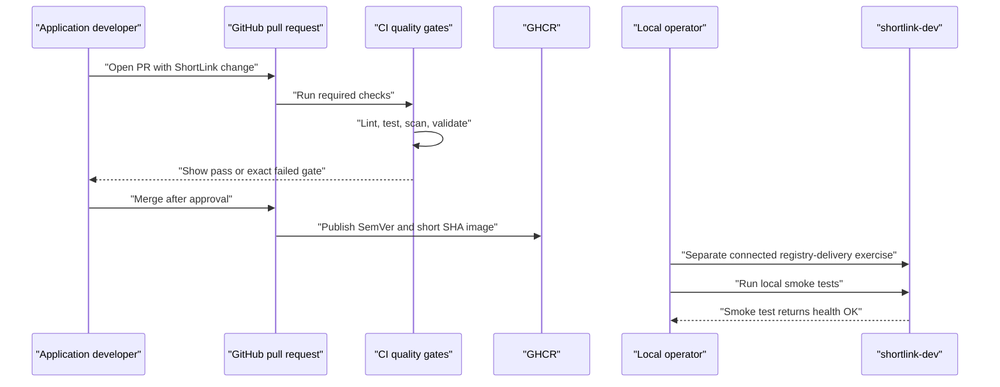
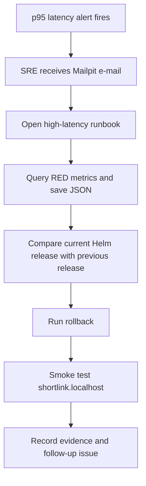
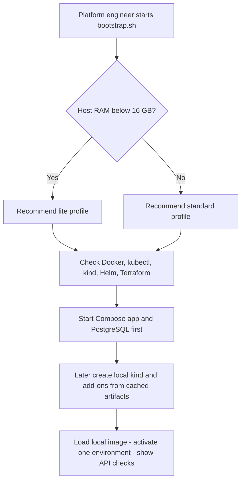

# Users and roles

Purpose: This document defines ShipIt users, their permissions, their journeys, and user stories linked to functional requirements.

## Roles

| Role | Main responsibility | Typical actions |
|---|---|---|
| Application developer | Build and change ShortLink safely. | Open pull requests, read CI failures, create test links, review logs. |
| DevOps engineer | Own builds, CI, images, Helm, and release automation. | Maintain workflows, image scans, chart releases, and deployment scripts. |
| Platform engineer | Own the local Kubernetes platform and IaC. | Create kind clusters, install add-ons, tune hardware profiles, write ADRs. |
| On-call SRE | Detect incidents and restore service. | Query Prometheus/Alertmanager APIs, read logs, run runbooks, rollback releases. |
| Engineering manager | Check release confidence and learning progress. | Review saved metric/alert JSON, demo evidence, DORA notes, and final readiness. |
| ShortLink end user | Use a short URL. | Request `GET /{code}` through the public route. |

## Personas

| Persona | Role | Goals | Pain points | Technical comfort |
|---|---|---|---|---|
| Ananya Rao | Application developer | Ship link features without breaking prod. | Manual deployments hide dependency and database problems. | Medium |
| Rohan Menon | Platform engineer | Keep a reproducible local platform on student laptops. | Tool versions drift between Windows, macOS, and Linux. | High |
| Meera Iyer | On-call SRE | Respond to alerts with a clear checklist. | Old incidents had no metrics, no owner, and no rollback record. | Medium |
| Kavya Nair | Engineering manager | See whether the fresher can explain DevOps trade-offs. | Demo projects often show tools without evidence of safe operation. | Low |

## Permission matrix

| Action | Application developer | DevOps engineer | Platform engineer | On-call SRE | Engineering manager | ShortLink end user |
|---|---:|---:|---:|---:|---:|---:|
| Create a short link with `POST /api/v1/links` | Yes | Yes | Yes | Yes | No | No |
| Use a redirect at `GET /{code}` | Yes | Yes | Yes | Yes | Yes | Yes |
| Delete a link with the optional API key feature | Dev only | Yes | No | Emergency only | No | No |
| Merge a pull request | After green CI | Yes | Yes | Emergency only | No | No |
| Change Helm values | Dev values only | Yes | Yes | Prod hotfix with PR | No | No |
| Create or destroy kind cluster | No | No | Yes | No | No | No |
| Run `smoke-test.sh` | Yes | Yes | Yes | Yes | No | No |
| Run `db-backup.sh` or `db-restore.sh` | No | Yes | Yes | Yes | No | No |
| Read Prometheus API/CLI evidence | Yes | Yes | Yes | Yes | Yes | No |
| Acknowledge or triage an alert | No | Yes | Yes | Yes | No | No |
| Edit local secret source file | No | Yes | Yes | No | No | No |
| Approve prod promotion | No | Yes | Yes | Yes | Yes | No |

## Key user journeys

### Journey 1: Pull request to safe dev deployment

Local startup is a different path: build the image locally, load it with `kind load docker-image`, then install Helm values with the loaded tag and `IfNotPresent`. Compose comes first. Neither local path waits for GitHub/GHCR.

### Journey 2: Alert to rollback

### Journey 3: Platform bootstrap on a laptop

## User stories

| ID | Story | Linked FR IDs |
|---|---|---|
| US-01 | As an application developer, I want to create deterministic short links, so that I can test the service through API calls. | FR-APP-01 |
| US-02 | As a ShortLink API client, I want a temporary redirect (302 Found), so that I receive the target Location without a custom frontend. | FR-APP-02 |
| US-03 | As an SRE, I want health, readiness, metrics, JSON logs, and environment configuration, so that I can diagnose the app in Kubernetes. | FR-APP-03, FR-APP-04 |
| US-04 | As a DevOps engineer, I want a secure image and Compose stack, so that local builds match the deployed service. | FR-CON-01, FR-CON-02 |
| US-05 | As an SRE, I want operational scripts for bootstrap, smoke testing, backup, and restore, so that routine actions are repeatable. | FR-BASH-01 |
| US-06 | As a developer, I want pull request gates and branch protection, so that unsafe code cannot reach `main`. | FR-CI-01, FR-CI-03 |
| US-07 | As a release engineer, I want GHCR images tagged by SemVer and short SHA, so that every deployment is traceable. | FR-CI-02 |
| US-08 | As a platform engineer, I want separate dev/prod definitions and persisted databases exercised sequentially, so that environments do not collide or exceed the lite budget. | FR-K8S-01, FR-K8S-02, FR-K8S-03, FR-K8S-05, FR-LOCAL-01 |
| US-09 | As an SRE, I want hardened pods, probes, and zero-downtime rolling updates, so that production stays available during normal releases. | FR-K8S-04, FR-K8S-06 |
| US-10 | As a DevOps engineer, I want a Helm chart with dev and prod values, so that releases are repeatable and rollback is simple. | FR-HELM-01, FR-HELM-02 |
| US-11 | As a platform engineer, I want Terraform 1.16.x with state, variables, outputs, and one module, so that platform add-ons are reproducible. | FR-IAC-01, FR-IAC-02 |
| US-12 | As an engineering manager, I want Prometheus API/CLI evidence, so that rate, errors, duration, CPU, memory, and restarts are auditable without frontend implementation. | FR-OBS-01, FR-OBS-02 |
| US-13 | As an on-call SRE, I want Mailpit alert e-mail and runbooks, so that I can act on high error rate, latency, crash loops, and target-down alerts. | FR-OBS-03, FR-OBS-04, FR-REL-01 |
| US-14 | As an SRE, I want recorded reliability drills, so that rollback, self-healing, and rolling updates are proven before the final demo. | FR-REL-02 |
| US-15 | As a DevOps engineer, I want security scans and dependency automation, so that known vulnerable images or dependencies are blocked early. | FR-SEC-01, FR-SEC-02 |
| US-16 | As a fresher, I want a local-to-AWS mapping, so that I can explain the project in interviews. | FR-DOC-01 |
| US-17 | As a DevOps engineer, I want optional GitOps, deeper tests, and Jenkins comparison, so that I can extend the portfolio after Must scope. | FR-GITOPS-01, FR-TEST-01, FR-JENKINS-01 |
| US-18 | As an SRE, I want optional logs, scaling, SLOs, and postmortem practice, so that I can show production-thinking depth. | FR-LOG-01, FR-SCALE-01, FR-SLO-01, FR-POST-01 |
| US-19 | As a platform engineer, I want optional network policy, PodDisruptionBudget, multi-node kind, Terraform tests, and secret encryption, so that the local platform resembles a real cluster. | FR-NET-01, FR-K8S-07, FR-KIND-01, FR-IAC-03, FR-SECRETS-01 |
| US-20 | As an advanced learner, I want local stretch automation, canary, signing, tracing, artifact validation, and database-operator experiments, so that I can discuss DevOps trade-offs without cloud deployment. | FR-ANSIBLE-01, FR-ROLLOUT-01, FR-SIGN-01, FR-OTEL-01, FR-LOCAL-02, FR-DBOP-01 |
| US-21 | As a student, I want one local start/stop interface, fictional seed, and offline demo, so that I can run Compose then kind without a registry or cloud account. | FR-LOCAL-01 |

[Back to README](../README.md)
