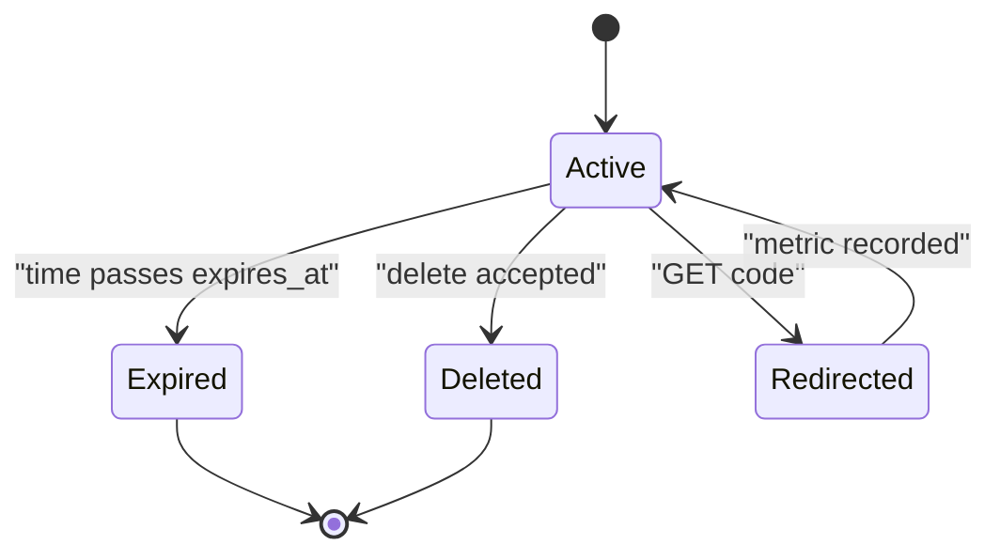
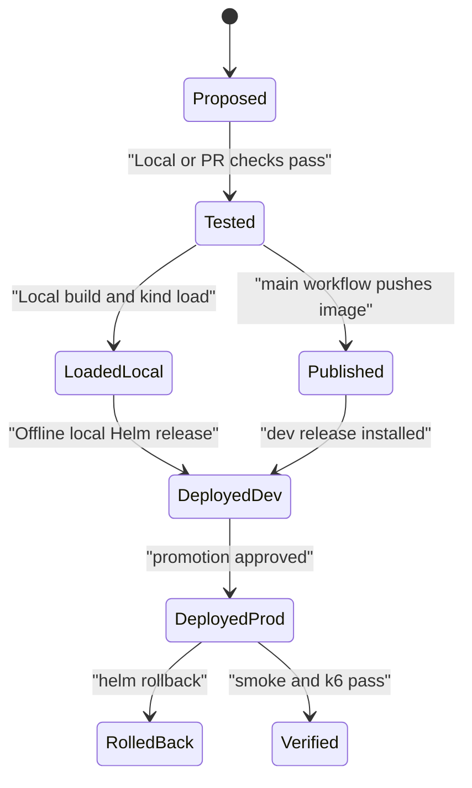

# Functional requirements

Purpose: This document defines ShipIt functional requirements, acceptance criteria, business rules, state machines, validation rules, and error scenarios.

## Summary table

| ID | Title | Priority | Roles | Linked BRs |
|---|---|---|---|---|
| FR-APP-01 | Create short links | Must | Application developer | BR-01, BR-02, BR-03, BR-04 |
| FR-APP-02 | Redirect short links | Must | ShortLink end user | BR-01, BR-04, BR-05, BR-06 |
| FR-APP-03 | Expose health, readiness, and metrics | Must | SRE, DevOps engineer | BR-07 |
| FR-APP-04 | Use JSON logs and environment configuration | Must | DevOps engineer | BR-08, BR-09 |
| FR-CON-01 | Build a secure application image | Must | DevOps engineer | BR-10, BR-11 |
| FR-CON-02 | Run local development with Compose | Must | Application developer | BR-12 |
| FR-BASH-01 | Provide operational shell scripts | Must | SRE, DevOps engineer | BR-13, BR-14 |
| FR-LOCAL-01 | Local Compose/kind operation contract | Must | Developer, Platform engineer | BR-57 |
| FR-CI-01 | Run pull request quality gates | Must | Developer, DevOps engineer | BR-15 |
| FR-CI-02 | Publish main branch images to GHCR | Must | DevOps engineer | BR-16 |
| FR-CI-03 | Protect the main branch | Must | Engineering manager | BR-15, BR-17 |
| FR-K8S-01 | Create Kubernetes environments | Must | Platform engineer | BR-18, BR-19 |
| FR-K8S-02 | Route traffic with Gateway API | Must | DevOps engineer | BR-20, BR-21 |
| FR-K8S-03 | Separate configuration and secrets | Must | DevOps engineer | BR-09, BR-22 |
| FR-K8S-04 | Harden pods and define probes | Must | SRE | BR-23, BR-24 |
| FR-K8S-05 | Run PostgreSQL on Kubernetes | Must | Platform engineer | BR-19, BR-25 |
| FR-K8S-06 | Perform zero-downtime rolling updates | Must | SRE | BR-26 |
| FR-HELM-01 | Package ShortLink with Helm | Must | DevOps engineer | BR-27 |
| FR-HELM-02 | Maintain dev and prod values | Must | DevOps engineer | BR-18, BR-19, BR-21 |
| FR-IAC-01 | Provision the local platform with Terraform | Must | Platform engineer | BR-28, BR-29 |
| FR-IAC-02 | Use state, variables, outputs, and one module | Must | Platform engineer | BR-29 |
| FR-OBS-01 | Install kube-prometheus-stack | Must | SRE | BR-30 |
| FR-OBS-02 | Query RED and resource evidence | Must | SRE, Engineering manager | BR-07, BR-31 |
| FR-OBS-03 | Define mandatory alert rules | Must | SRE | BR-32 |
| FR-OBS-04 | Deliver alerts to Mailpit e-mail | Must | SRE | BR-33 |
| FR-REL-01 | Write alert runbooks | Must | SRE | BR-34 |
| FR-REL-02 | Run reliability drills with evidence | Must | SRE | BR-26, BR-35 |
| FR-SEC-01 | Scan images and manifests | Must | DevOps engineer | BR-10, BR-36 |
| FR-SEC-02 | Automate dependency hygiene | Must | DevOps engineer | BR-37 |
| FR-DOC-01 | Map the local platform to AWS | Must | Engineering manager | BR-38 |
| FR-APP-05 | Add optional ShortLink features | Should | Application developer | BR-39 |
| FR-GITOPS-01 | Add Argo CD GitOps | Should | DevOps engineer | BR-40 |
| FR-LOG-01 | Add Loki and Grafana Alloy logs | Should | SRE | BR-41 |
| FR-SCALE-01 | Add HPA and metrics-server | Should | SRE | BR-42 |
| FR-NET-01 | Enforce NetworkPolicy with Calico | Should | Platform engineer | BR-43 |
| FR-KIND-01 | Use a multi-node kind profile | Should | Platform engineer | BR-44 |
| FR-K8S-07 | Add prod PodDisruptionBudget | Should | Platform engineer, SRE | BR-56 |
| FR-TEST-01 | Add deeper platform tests and SBOM | Should | DevOps engineer | BR-45 |
| FR-SECRETS-01 | Use SOPS or Sealed Secrets | Should | DevOps engineer | BR-46 |
| FR-SLO-01 | Add SLO queries and burn alerts | Should | SRE | BR-47 |
| FR-POST-01 | Write a postmortem and DORA notes | Should | Engineering manager | BR-48 |
| FR-HELM-03 | Add helm-unittest | Should | DevOps engineer | BR-45 |
| FR-IAC-03 | Add Terraform tests and lint | Should | Platform engineer | BR-45 |
| FR-JENKINS-01 | Document a Jenkins equivalent pipeline | Should | DevOps engineer | BR-49 |
| FR-ANSIBLE-01 | Prepare an Ubuntu VM with Ansible | Could | Platform engineer | BR-50 |
| FR-ROLLOUT-01 | Try canary delivery with Argo Rollouts | Could | SRE | BR-51 |
| FR-SIGN-01 | Sign images and enforce policy | Could | DevOps engineer | BR-52 |
| FR-OTEL-01 | Add OpenTelemetry tracing | Could | SRE | BR-53 |
| FR-LOCAL-02 | Validate offline artifact/rollback inventory | Could | Platform engineer | BR-54 |
| FR-DBOP-01 | Evaluate CloudNativePG | Could | Platform engineer | BR-55 |

## Must functional requirements

### FR-APP-01 — Create short links

Priority: Must. Roles: Application developer. Linked BRs: BR-01, BR-02, BR-03, BR-04.

Description: ShortLink MUST accept `POST /api/v1/links` with a target URL. The service MUST store a unique short code and return it in a response body. Generated codes MUST follow the exact rule in BR-01. Invalid URLs MUST NOT create a row.

Acceptance criteria:

- Given request body `{"target_url":"https://example.in/careers"}`, when the developer calls `POST /api/v1/links`, then the API returns 201 with `code` length 7, `short_url`, and `target_url`.
- Given target URL `ftp://example.in/file`, when the developer calls `POST /api/v1/links`, then the API returns 422 with error code `target-url-invalid`, and no link row is created.
- Given five generated-code collisions in a row, when the API cannot create a unique code, then it returns 503 with error code `code-space-retry-exhausted`.

### FR-APP-02 — Redirect short links

Priority: Must. Roles: ShortLink end user. Linked BRs: BR-01, BR-04, BR-05, BR-06.

Description: ShortLink MUST redirect `GET /{code}` to the stored target URL. The redirect status MUST be 302 Found, so browsers do not permanently cache links that can expire or be deleted. Each successful redirect MUST increment the redirect metric. Missing, expired, or deleted codes MUST return deterministic errors.

Acceptance criteria:

- Given code `Ab3kP91` points to `https://example.in/careers`, when a user requests `GET /Ab3kP91`, then the response is 302 with `Location: https://example.in/careers`.
- Given code `missing1` does not exist, when a user requests `GET /missing1`, then the response is 404 with error code `short-code-not-found`.
- Given code `old2026` expired at `2026-10-01T00:00:00+05:30`, when a user requests it on `2026-10-02`, then the response is 410 with error code `short-code-expired`.

### FR-APP-03 — Expose health, readiness, and metrics

Priority: Must. Roles: SRE, DevOps engineer. Linked BRs: BR-07.

Description: The app MUST expose `/healthz`, `/readyz`, and `/metrics`. Health checks MUST report process health only. Readiness MUST check PostgreSQL connectivity. Metrics MUST use the exact names in BR-07.

Acceptance criteria:

- Given the app process is running, when Kubernetes calls `/healthz`, then it returns 200 with status `ok`.
- Given PostgreSQL is unavailable, when Kubernetes calls `/readyz`, then it returns 503 with status `not_ready`.
- Given one successful redirect, when Prometheus scrapes `/metrics`, then `shortlink_redirects_total` increases by 1.

### FR-APP-04 — Use JSON logs and environment configuration

Must requirement for the DevOps engineer. Linked rules: BR-08 and BR-09.

Description: The app MUST read configuration from environment variables. It MUST write JSON logs with request ID, method, path, status, and latency. Secrets MUST NOT be logged. Missing required configuration MUST fail startup clearly.

Acceptance criteria:

- Given `DATABASE_URL` and `APP_ENV=prod`, when the app starts, then logs include JSON field `app_env` with value `prod`.
- Given `DATABASE_URL` is absent, when the app starts, then it exits non-zero and logs error code `config-missing-database-url`.
- Given request ID `req-demo-001`, when `POST /api/v1/links` succeeds, then one log entry contains `request_id`, `method`, `path`, `status_code`, and `duration_ms`.

### FR-CON-01 — Build a secure application image

Must requirement owned by the DevOps engineer. Linked rules: BR-10 and BR-11.

Description: The student MUST provide a multi-stage Docker build for ShortLink. The final image MUST use a slim base, run as a non-root user, include a health check, and stay below 200 MB. Secrets MUST NOT appear in image layers.

Acceptance criteria:

- Given the image is built from a clean clone, when CI inspects it, then the final image size is below 200 MB and the runtime user is not root.
- Given a fake secret string is present in local `.env`, when the image is built, then the string is not found in the image history or filesystem.

### FR-CON-02 — Run local development with Compose

Priority: Must. Roles: Application developer. Linked BRs: BR-12.

Description: Docker Compose MUST be the first runnable local stage: app plus PostgreSQL, local migrations/fictional seed, loopback app port 8080, persistent named database volume, and proposed memory caps from document 06. Compose health checks MUST wait for PostgreSQL before the app is considered ready. Use a locally built app image and pinned PostgreSQL image; no GitHub/GHCR credential is required.

Acceptance criteria:

- Given Docker is running, when the developer starts the Compose stack, then app and PostgreSQL services become healthy.
- Given required credentials are missing from an ignored local env file, when the local entrypoint runs, then it exits 2 with `secret-value-missing: DATABASE_URL` before starting services and prints no secret values.

### FR-BASH-01 — Provide operational shell scripts

Priority: Must. Roles: SRE, DevOps engineer. Linked BRs: BR-13, BR-14.

Description: The repository MUST include `bootstrap.sh`, `smoke-test.sh`, `db-backup.sh`, and `db-restore.sh`. Scripts MUST use strict mode, help text, clear failures, and pass ShellCheck. `bootstrap.sh` MUST detect RAM and recommend lite profile below 16 GB.

Acceptance criteria:

- Given a host with 8 GB RAM, when `bootstrap.sh` runs in check mode, then it recommends the lite profile and lists missing prerequisites.
- Given no backup file is supplied, when `db-restore.sh` runs, then it exits non-zero with usage text and changes no database.
- Given a backup is older than 7 days, when `db-backup.sh` completes, then the old backup is removed.

### FR-LOCAL-01 — Local Compose/kind operation contract

Priority: Must. Roles: Developer, Platform engineer. Linked BRs: BR-57.

Students MUST implement the start/stop/demo/reset contract in document 06. Stage 1 is Compose; stage 2 is local kind using a locally built, immutable SHA-derived tag and `kind load docker-image`, with `imagePullPolicy: IfNotPresent` (or `Never` for the isolated lab). GitHub/GHCR delivery is a separate CI exercise. Local startup MUST initialize migrations and fictional seed once, retain data across stop/start, bind published ports to loopback, and never download/fall back to registry delivery when isolated.

Acceptance criteria:
- Given dependencies/images/charts/providers are prepared, when `make local-start` runs on a clean clone, then Compose app/PostgreSQL become healthy and stdout includes `local-ready stage=compose env=dev`.
- Given Compose is stopped and a one-node kind lite profile is selected, when `make local-start STAGE=kind PROFILE=lite ENV=prod` runs, then only prod app/database workloads run, a loaded local image is used, and `local-ready stage=kind env=prod` is printed.
- Given external egress is denied after preparation, when either stage's local demo runs, then the seeded `Ab3kP91` returns 302 with `Location: https://example.in/careers` without following that URL.
- Given a saved code exists, when local stop/start runs for the same stage/environment, then it remains queryable; an unconfirmed reset changes no data.
- Given Docker is unavailable or a cached artifact is missing, when startup runs, then it exits 2 with `local-dependency-unavailable: docker` or `local-artifact-missing: <path>` and no external request.

### FR-CI-01 — Run pull request quality gates

Priority: Must. Roles: Developer, DevOps engineer. Linked BRs: BR-15.

Description: GitHub Actions MUST run on every pull request and every push to `main`. It MUST run Ruff, mypy, hadolint, ShellCheck, tests with coverage, image build, Trivy image scan, Gitleaks, Helm lint, kubeconform, Terraform format check, Terraform validate, and local acceptance for both Compose and one-node kind. Download/cache preparation precedes the isolated acceptance phase.

Acceptance criteria:

- Given a pull request changes app code, when CI runs, then all required gates in BR-15 appear as checks.
- Given a commit is pushed to `main`, when CI runs, then all mandatory validation gates run before image publishing.
- Given tests produce 79% line coverage, when CI evaluates coverage, then the pull request fails because the Must threshold is 80%.

### FR-CI-02 — Publish main branch images to GHCR

Must release requirement for the DevOps engineer. Linked rule: BR-16.

Description: The separate connected `main` branch workflow MUST publish ShortLink images to GHCR. The SemVer tag MUST come from the declared application version. Every `main` build MUST also publish the short commit SHA tag. Reject reuse of a SemVer tag for a different digest; registry delivery pins short SHA or digest. Local startup instead pins a loaded `shortlink:local-<short-sha>` tag and requires no registry login, GitHub availability, or published image.

Acceptance criteria:

- Given application version `v1.2.0` and commit `abc1234`, when the `main` workflow succeeds, then GHCR contains tags `v1.2.0` and `abc1234` for the same digest.
- Given GHCR already has `v1.2.0` for another digest, when publishing runs, then the workflow fails before changing prod deployment inputs.
- Given Trivy finds a CRITICAL vulnerability, when the workflow reaches publishing, then no GHCR image is pushed.

### FR-CI-03 — Protect the main branch

Priority: Must. Roles: Engineering manager. Linked BRs: BR-15, BR-17.

Description: The student repository MUST protect `main`. Required checks MUST include CI gates from BR-15. Direct pushes to `main` MUST be disabled.

Acceptance criteria:

- Given a pull request has a failing Gitleaks check, when the student attempts to merge, then GitHub blocks the merge.
- Given a local direct push to `main`, when branch protection is enabled, then GitHub rejects the push.

### FR-K8S-01 — Create Kubernetes environments

Priority: Must. Roles: Platform engineer. Linked BRs: BR-18, BR-19.

Description: The platform MUST define namespaces `shortlink-dev` and `shortlink-prod` in kind, with independent resources. Only one app environment runs at once in the canonical local profiles: inactive app/PostgreSQL replicas are 0 and PVCs remain. Active dev has 1 app replica; active prod has 1 in lite or 2 in standard. The 8 GB profile MUST remain one-node; multi-node is standard-only Should.

Acceptance criteria:

- Given the cluster is provisioned, when the engineer lists namespaces, then `shortlink-dev` and `shortlink-prod` exist.
- Given lite prod is active, when pods are listed, then exactly 1 ready prod app pod and 1 prod database pod exist; dev app/database replicas are 0.
- Given standard prod is active, when pods are listed, then exactly 2 ready prod app pods exist; both profiles retain independent dev/prod resource definitions.

### FR-K8S-02 — Route traffic with Gateway API

Must routing requirement for the DevOps engineer. Linked rules: BR-20 and BR-21.

Description: The platform MUST use one platform-owned GatewayClass and Gateway with Envoy Gateway. Accept HTTPRoutes from `shortlink-dev` and `shortlink-prod`, using hosts `shortlink-dev.localhost` and `shortlink.localhost`. Host access MUST use loopback Envoy port-forward at `127.0.0.1:8081` and the selected Host header. An inactive route MUST NOT reach the active environment.

Acceptance criteria:

- Given prod is active and port-forward is active, when `curl -H "Host: shortlink.localhost" http://127.0.0.1:8081/healthz` runs, then prod responds with 200.
- Given dev is active and port-forward is active, when `curl -H "Host: shortlink-dev.localhost" http://127.0.0.1:8081/healthz` runs, then dev responds and prod is not reached.
- Given both HTTPRoutes exist, when their parent references are checked, then both attach to the same platform-owned Gateway.

### FR-K8S-03 — Separate configuration and secrets

Must configuration requirement for the DevOps engineer. Linked rules: BR-09 and BR-22.

Description: Kubernetes configuration MUST use ConfigMaps for non-secret values and Secrets for sensitive values. Secrets MUST be created from a local ignored file by `scripts/create-secrets.sh`. Secret files MUST NOT be committed.

Acceptance criteria:

- Given the prod release is installed, when the engineer inspects resources, then app environment values come from ConfigMap and Secret references.
- Given the secret source file is missing, when the secret creation script runs, then it exits non-zero with message `secret-file-missing`.

### FR-K8S-04 — Harden pods and define probes

Must runtime-safety requirement for the SRE. Linked rules: BR-23 and BR-24.

Description: App pods MUST set requests, limits, liveness probes, readiness probes, startup probes, and restrictive security context. Containers MUST run as non-root, drop ALL capabilities, and use a read-only root filesystem.

Acceptance criteria:

- Given manifests are rendered, when kubeconform and policy checks run, then each app container has CPU and memory requests and limits.
- Given the readiness endpoint returns 503, when Kubernetes checks the pod, then the pod is removed from Service endpoints.

### FR-K8S-05 — Run PostgreSQL on Kubernetes

Priority: Must. Roles: Platform engineer. Linked BRs: BR-19, BR-25.

Description: Each environment MUST have its own PostgreSQL StatefulSet, PVC, and Service. Only the selected environment's database has replicas 1; inactive databases have replicas 0 and retained PVCs. Use durable local storage and migration/seed initialization as in document 06. No operator or Bitnami image/chart is allowed for Must scope.

Acceptance criteria:

- Given both definitions are installed, when StatefulSets are listed, then each namespace has one PostgreSQL StatefulSet/PVC; only the active one runs a pod.
- Given a fictional dev-only link was stored, when dev stops and prod starts, then prod readiness is 200 and that code is absent from prod's independent database.

### FR-K8S-06 — Perform zero-downtime rolling updates

Must release-safety requirement for the SRE. Linked rule: BR-26.

Description: Active prod MUST use `maxUnavailable: 0` and `maxSurge: 1`. Lite starts at 1 replica with budget for a second temporary app pod; standard starts at 2 with budget for a third. Preload old/new/rollback images locally before isolation. A release update MUST keep serving requests during profile-appropriate k6 load; rollout status is captured through kubectl.

Acceptance criteria:

- Given k6 sends redirect traffic, when the prod image updates, then the k6 report shows 0 failed requests.
- Given a new prod pod fails readiness, when a rollout starts, then old ready pods continue serving traffic.

### FR-HELM-01 — Package ShortLink with Helm

Must packaging requirement for the DevOps engineer. Linked rule: BR-27.

Description: The student MUST create an own Helm chart named `shortlink`. The chart MUST include templates for app, PostgreSQL, ServiceMonitor, Gateway resources, and a `helm test` hook. The chart MUST have a chart version.

Acceptance criteria:

- Given the chart is rendered, when `helm lint` runs, then it passes with chart name `shortlink`.
- Given the release is installed, when `helm test` runs, then the test hook verifies `/healthz` and `/readyz`.

### FR-HELM-02 — Maintain dev and prod values

Must environment-values requirement for the DevOps engineer. Linked rules: BR-18, BR-19, and BR-21.

Description: The chart MUST provide dev/prod values plus lite/standard profile overlays and an `environmentActive` switch. Active dev uses 1 replica and `shortlink-dev.localhost`; active prod uses 1 replica in lite or 2 in standard and `shortlink.localhost`. Inactive app/database replica counts are 0. Local values select loaded immutable tags and `IfNotPresent`/`Never`, not registry-only inputs.

Acceptance criteria:

- Given dev values are rendered, when the engineer checks the output, then host is `shortlink-dev.localhost` and app replicas equal 1.
- Given prod values plus lite overlay are rendered, then host is `shortlink.localhost`, replicas are 1, and pull policy allows a loaded image.
- Given prod values plus standard overlay are rendered, then replicas are 2; an inactive overlay renders 0 app/database replicas with PVC retention.

### FR-IAC-01 — Provision the local platform with Terraform

Priority: Must. Roles: Platform engineer. Linked BRs: BR-28, BR-29.

Description: Terraform 1.16.x MUST be the default IaC tool. After Compose is stopped, one apply creates local kind and installs Envoy Gateway/kube-prometheus-stack through the Helm provider. Use cached provider binaries, local chart archives/CRDs, and preloaded add-on images for the offline lab; do not require cloud credentials. OpenTofu MAY be used only with an ADR.

Acceptance criteria:

- Given Terraform is initialized, when the engineer applies the platform, then kind cluster, Envoy Gateway, and kube-prometheus-stack are installed.
- Given a student chooses OpenTofu, when the repository is reviewed, then an ADR explains the choice and version.

### FR-IAC-02 — Use state, variables, outputs, and one module

Priority: Must. Roles: Platform engineer. Linked BRs: BR-29.

Description: Terraform MUST use local state that is ignored by Git. It MUST include variables with validation, outputs for key endpoints, and one reusable module. Variables MUST cover profile, Kubernetes version, and add-on versions.

Acceptance criteria:

- Given `profile=unknown`, when Terraform validates variables, then validation fails before apply.
- Given apply completes, when outputs are shown, then they include cluster name, dev/prod Host headers, Gateway loopback URL, Prometheus URL, and Alertmanager URL.

### FR-OBS-01 — Install kube-prometheus-stack

Must monitoring-stack requirement for the SRE. Linked rule: BR-30.

Description: The platform MUST install kube-prometheus-stack with Helm. Prometheus MUST discover the active ShortLink environment through ServiceMonitor; inactive environments are excluded from target-down/RED rules. Lite retention is 6 hours. Grafana is disabled by default and in lite; standard MAY use unmodified built-in consoles for operations only.

Acceptance criteria:

- Given ShortLink is deployed, when Prometheus targets are viewed, then the ShortLink target is up.
- Given the lite profile is selected, when Prometheus values are reviewed, then retention is 6 hours.

### FR-OBS-02 — Query RED and resource evidence

Priority: Must. Roles: SRE, Engineering manager. Linked BRs: BR-07, BR-31.

Description: Students MUST query Prometheus's HTTP API using curl, a Python client, or CLI commands and save JSON/text evidence for request rate, 5xx rate, p50/p95/p99 latency, CPU, memory, and restarts. Evidence records query, timestamp, environment, result values/units, and interpretation. No custom Grafana dashboard/panel/visualization is authored or exported; built-in Grafana is optional operations tooling only.

Acceptance criteria:

- Given a fixture generates 100 valid redirects and 10 missing-code requests without following redirects, when before/after metrics are compared, then request delta is 110, redirect delta is 100, and 5xx delta is 0; saved Prometheus responses have `status: success`.
- Given a pod restarts once, when the restart series is queried, then the saved result for that pod is at least 1. Document 08 defines the required PromQL evidence.

### FR-OBS-03 — Define mandatory alert rules

Must alert-rule requirement for the SRE. Linked rule: BR-32.

Description: PrometheusRules MUST cover high error rate, high p95 latency, crash-looping pods, and target down. Thresholds and durations MUST match BR-32.

Acceptance criteria:

- Given 5xx responses exceed 5% for 5 minutes, when Prometheus evaluates rules, then alert `ShortLinkHighErrorRate` fires.
- Given p95 latency is 450 ms, when rules evaluate, then `ShortLinkHighLatencyP95` does not fire because the threshold is above 500 ms.
- Given a test delay keeps p95 above 600 ms for at least 10 minutes, when rules evaluate, then `ShortLinkHighLatencyP95` fires with severity warning.
- Given a pod has at least 3 restarts within 10 minutes sustained for 5 minutes, when rules evaluate, then `ShortLinkPodCrashLooping` fires with severity critical.

### FR-OBS-04 — Deliver alerts to Mailpit e-mail

Must alert-delivery requirement for the SRE. Linked rule: BR-33.

Description: Alertmanager MUST send alerts to Mailpit by e-mail with at-least-once delivery. Stable identity is alert name plus labels. Duplicate Mailpit messages are allowed. A webhook receiver SHOULD be available as an additional receiver. Alert messages MUST include service, environment, severity, summary, and runbook link.

Acceptance criteria:

- Given `ShortLinkTargetDown` fires, when Alertmanager routes the alert, then Mailpit receives at least 1 matching e-mail with environment `prod`.
- Given Mailpit is unreachable, when Alertmanager sends the alert, then notification failure metrics or logs show the failed delivery.

### FR-REL-01 — Write alert runbooks

Must runbook requirement for the SRE. Linked rule: BR-34.

Description: The student MUST write one runbook for each mandatory alert. Each runbook MUST include symptoms, impact, diagnosis, mitigation, escalation, and evidence to collect.

Acceptance criteria:

- Given `ShortLinkHighLatencyP95` fires, when the SRE opens its runbook, then it lists Prometheus API queries, pod/log commands, rollback conditions, and escalation owner.
- Given a mandatory alert lacks a runbook link, when the alert catalog is reviewed, then the requirement is not complete.

### FR-REL-02 — Run reliability drills with evidence

Must drill-evidence requirement for the SRE. Linked rules: BR-26 and BR-35.

Description: The student MUST document three drills: zero-downtime rolling update, rollback with Helm, and pod kill self-healing. Evidence MUST include commands, timestamps, expected result, and observed result.

Acceptance criteria:

- Given a rolling update drill is complete, when evidence is reviewed, then it includes k6 summary with 0 failed requests.
- Given a rollback drill is complete, when evidence is reviewed, then it names the rolled-back Helm release revision.

### FR-SEC-01 — Scan images and manifests

Must scanning requirement for the DevOps engineer. Linked rules: BR-10 and BR-36.

Description: CI MUST scan the image and Kubernetes manifests. Trivy image scan MUST fail on CRITICAL vulnerabilities and HIGH vulnerabilities with a fix available. Trivy config scan MUST have 0 unexplained HIGH misconfigurations.

Acceptance criteria:

- Given Trivy reports a CRITICAL OpenSSL finding in the image, when CI runs, then the image scan fails.
- Given a HIGH manifest misconfiguration is accepted, when the PR is reviewed, then a written justification must name the risk and mitigation.

### FR-SEC-02 — Automate dependency hygiene

Must dependency-maintenance requirement for the DevOps engineer. Linked rule: BR-37.

Description: Dependabot MUST cover GitHub Actions, pip, and Docker. The student MUST review dependency PRs through the same quality gates as feature PRs.

Acceptance criteria:

- Given a new GitHub Actions version is available, when Dependabot checks, then it opens a PR for the update.
- Given a dependency PR fails tests, when branch protection evaluates it, then merge is blocked.

### FR-DOC-01 — Map the local platform to AWS

Priority: Must. Roles: Engineering manager. Linked BRs: BR-38.

Description: The documentation MUST map local tools to AWS services without requiring an AWS account. The interview guide MUST explain IAM, VPC, subnets, security groups, EC2, and S3 basics using ShipIt examples.

Acceptance criteria:

- Given the local-to-AWS table is reviewed, when `kind`, `GHCR`, `PVC`, `Gateway`, `Alertmanager e-mail`, and `local Terraform state` are checked, then each has one AWS equivalent.
- Given a student cannot explain why remote state belongs in S3 with locking, when viva happens, then the cloud literacy outcome is incomplete.

## Should and Could functional requirements

| ID | Requirement detail | Acceptance criteria |
|---|---|---|
| FR-APP-05 | Add custom alias, expiry, stats endpoint, API-key delete, and Valkey cache-aside TTL after Must scope. | Valid alias `team-demo` creates a link; duplicate alias returns 409; cache ADR names Valkey or Redis licence reason. |
| FR-GITOPS-01 | Add Argo CD 3.5.x watching `deploy/` in the student repository. Dev syncs automatically. Prod syncs only after promotion PR approval. | Dev change becomes Synced automatically; prod remains OutOfSync until manual sync. |
| FR-LOG-01 | Add Loki 3.7.x and Grafana Alloy 1.20.x in a separately budgeted standard profile. Promtail MUST NOT be used. | Loki HTTP API/CLI finds a recorded request ID within 5 minutes; an unmodified built-in console may be inspected, not implemented. |
| FR-SCALE-01 | Standard-only: metrics-server and HPA at CPU target 70%, replicas 2 to 6, after a separate memory pre-check including surge. | k6 load increases replicas above 2 and returns to 2; lite remains fixed at 1 and never runs this drill. |
| FR-NET-01 | Add Calico 3.33.x or Cilium through ADR and enforce database isolation. | App connects to PostgreSQL; debug pod without label is denied. |
| FR-K8S-07 | Add a prod PodDisruptionBudget with `minAvailable: 1`. | On 1 node, drain is blocked as expected; on a multi-node cluster, drain completes with 0 failed requests. |
| FR-KIND-01 | Add a standard multi-node kind profile with 1 control plane and 2 workers. | Nodes list shows 3 Ready nodes and prod pods spread across workers when possible. |
| FR-TEST-01 | Add bats-core tests, SBOM, extended kind fault/deploy matrix beyond mandatory local acceptance, release workflow, yamllint, and TFLint. | Each script has at least 3 bats tests; tag `vX.Y.Z` starts release workflow. |
| FR-SECRETS-01 | Add SOPS with age or Sealed Secrets for encrypted secrets. | Plain database password is absent from Git, and the cluster can decrypt or consume the secret. |
| FR-SLO-01 | Add SLO PromQL/recording rules and burn-rate alerts with saved API evidence. | Saved query results identify 99.5% availability/p95 under 300 ms design targets; rule tests demonstrate short-window burn without claiming 30 days of local measurement. |
| FR-POST-01 | Write a blameless postmortem and basic DORA notes for a simulated bad release. | Postmortem includes timeline, impact, root cause, actions, and deployment frequency notes. |
| FR-HELM-03 | Add helm-unittest for important chart branches. | Tests cover dev host, prod replicas, and security context values. |
| FR-IAC-03 | Add `terraform test` and TFLint for the platform. | Invalid profile test fails; lint has 0 errors. |
| FR-JENKINS-01 | Write and explain a Jenkinsfile equivalent pipeline using Jenkins LTS in Docker. | The student can map each GitHub Actions gate to a Jenkins stage. |
| FR-ANSIBLE-01 | Prepare a fresh Ubuntu VM with Docker and kind through Ansible. | A Multipass Ubuntu VM can reach `kind version` after the playbook. |
| FR-ROLLOUT-01 | Try Argo Rollouts canary delivery. | A canary receives 10% traffic before promotion. |
| FR-SIGN-01 | Sign local images with cosign using an ignored local key and enforce Kyverno policy; prepare all images before isolation. No cloud signing account is required. | Unsigned local image is rejected in a test namespace; signed fixture passes. |
| FR-OTEL-01 | Add OpenTelemetry tracing. | One create-link request has a trace from API handler to database call. |
| FR-LOCAL-02 | Validate the offline artifact inventory and rollback image set with local checksums. | A changed chart/image artifact yields `artifact-digest-mismatch`; cached old/new/rollback images and charts can be verified without contacting a registry. |
| FR-DBOP-01 | Evaluate CloudNativePG as a Could database operator. | ADR compares StatefulSet Must design with operator trade-offs. |

## Business rules

| ID | Exact rule | Exact values | Used by |
|---|---|---|---|
| BR-01 | Generated codes MUST use cryptographically secure random selection. Retry on unique constraint collision. | Length 7; alphabet `0123456789ABCDEFGHIJKLMNOPQRSTUVWXYZabcdefghijklmnopqrstuvwxyz`; maximum 5 total generation attempts. | FR-APP-01, FR-APP-02 |
| BR-02 | Target URLs MUST be valid HTTP or HTTPS URLs. | Schemes `http`, `https`; maximum length 2048; host required; no username or password part. | FR-APP-01 |
| BR-03 | Create-link response MUST include stable fields. | `id`, `code`, `short_url`, `target_url`, `created_at`. | FR-APP-01 |
| BR-04 | Code lookup MUST treat active, expired, deleted, and missing links differently. | Active redirects; expired returns 410; deleted returns 410; missing returns 404. | FR-APP-01, FR-APP-02 |
| BR-05 | Redirect status MUST be temporary to avoid browser permanent caching. | HTTP 302 Found with `Location` header. | FR-APP-02 |
| BR-06 | Redirect outcomes MUST update metrics and optional event records. | Status values: `redirected`, `not_found`, `expired`, `deleted`. | FR-APP-02 |
| BR-07 | Metrics MUST use exact names. | `shortlink_http_requests_total`, `shortlink_http_request_duration_seconds`, `shortlink_redirects_total`, `shortlink_links_created_total`; `path` label uses route templates only; `/healthz`, `/readyz`, and `/metrics` are excluded from RED calculations. | FR-APP-03, FR-OBS-02 |
| BR-08 | Logs MUST be JSON objects with request context. | Fields: `timestamp`, `level`, `app_env`, `request_id`, `method`, `path`, `status_code`, `duration_ms`. | FR-APP-04 |
| BR-09 | Secrets MUST come from runtime configuration only. | Required env: `DATABASE_URL`, `APP_ENV`; optional `API_KEY`, `BASE_URL`. | FR-APP-04, FR-K8S-03 |
| BR-10 | The app image MUST be small and unprivileged. | Final image below 200 MB; non-root user; no secrets in layers. | FR-CON-01, FR-SEC-01 |
| BR-11 | The image MUST expose a health check. | Health path `/healthz`; expected 200. | FR-CON-01 |
| BR-12 | Compose is the first runnable local stage. | Services `app`, `postgres`; PostgreSQL 18.x; loopback app 8080; persistent named volume; local build, migrations/seed, health and proposed caps. | FR-CON-02 |
| BR-13 | Required scripts MUST use safe Bash. | `set -euo pipefail`, help flag, ShellCheck 0 findings. | FR-BASH-01 |
| BR-14 | Backups MUST rotate locally. | Timestamp `YYYYMMDD-HHMMSS`; retention 7 days; stream through `docker compose exec` in stage 1 or `kubectl exec` in selected PostgreSQL pod in stage 2; ignored local backup directory. | FR-BASH-01 |
| BR-15 | PR gates MUST include all mandatory checks. | Ruff, mypy, hadolint, ShellCheck, pytest coverage, image build, Trivy, Gitleaks, Helm lint, kubeconform/CRD schemas, Terraform fmt/validate, and TC-LOCAL-001 to TC-LOCAL-004 for both stages. | FR-CI-01, FR-CI-03 |
| BR-16 | CI registry images and local images MUST be traceable but independent. | GHCR SemVer/short SHA same digest; reject tag reuse; registry delivery pins SHA/digest. Offline local image is `shortlink:local-<short-sha>`, loaded into kind with `IfNotPresent` or `Never`. | FR-CI-02, FR-LOCAL-01 |
| BR-17 | Branch protection MUST block unsafe merges. | Required checks; no direct push to `main`; PR review before merge. | FR-CI-03 |
| BR-18 | Kubernetes environments MUST use exact namespaces/profile counts. | `shortlink-dev`, `shortlink-prod`; one active environment; active dev 1 app, prod lite 1/standard 2; inactive app/database 0. Lite is one-node only. | FR-K8S-01, FR-HELM-02 |
| BR-19 | Each environment MUST have independent persistent database resources. | One StatefulSet/PVC/Service/Secret per environment; only active database runs (1 pod); inactive PVC retained. | FR-K8S-01, FR-K8S-05, FR-HELM-02 |
| BR-20 | Gateway API MUST use a maintained implementation. | Envoy Gateway 1.9.x; one platform-owned GatewayClass and Gateway; ingress-nginx is not allowed. | FR-K8S-02 |
| BR-21 | Host names and stage ports MUST not collide. | Compose `127.0.0.1:8080`; kind Envoy `127.0.0.1:8081` with Host dev `shortlink-dev.localhost` or prod `shortlink.localhost`; no external DNS needed. | FR-K8S-02, FR-HELM-02 |
| BR-22 | Kubernetes Secrets MUST be created from an ignored local file. | The source file is never committed; `scripts/create-secrets.sh --env dev|prod --file <path>` creates the Kubernetes Secret. | FR-K8S-03 |
| BR-23 | Pods MUST be hardened. | `runAsNonRoot`, `readOnlyRootFilesystem`, drop `ALL` capabilities. | FR-K8S-04 |
| BR-24 | Probes MUST use app endpoints. | Liveness `/healthz`; readiness `/readyz`; startup `/healthz`. | FR-K8S-04 |
| BR-25 | Must PostgreSQL MUST avoid operators and Bitnami. | StatefulSet only; no operator; no Bitnami images or charts. | FR-K8S-05 |
| BR-26 | Active prod rolling updates MUST preserve availability. | Lite 1/standard 2 replicas; `maxUnavailable: 0`, `maxSurge: 1`; budget the extra pod; preload rollback images; 0 failed requests under profile-appropriate load. | FR-K8S-06, FR-REL-02 |
| BR-27 | Helm chart MUST be owned by the student. | Chart name `shortlink`; has dev/prod values and `helm test` hook. | FR-HELM-01 |
| BR-28 | Terraform is the default IaC tool. | Terraform 1.16.x; OpenTofu only with ADR. | FR-IAC-01 |
| BR-29 | Terraform scope MUST stay small. | One apply creates kind and installs Envoy Gateway and kube-prometheus-stack; local state ignored; one module. | FR-IAC-01, FR-IAC-02 |
| BR-30 | Monitoring stack MUST use kube-prometheus-stack. | Helm 91.x; lite retention 6 hours; discover active environment only; Grafana off in lite/default, unmodified optional standard operations tool. | FR-OBS-01 |
| BR-31 | Saved Prometheus API/CLI evidence MUST show RED and resources. | Rate, 5xx errors, p50/p95/p99, CPU, memory, restarts; include query/time/environment/values/units; no custom dashboard/panel exports. | FR-OBS-02 |
| BR-32 | Mandatory alerts MUST use exact thresholds. | 5xx greater than 5% for 5 minutes; p95 greater than 500 ms for 10 minutes; at least 3 container restarts within 10 minutes sustained for 5 minutes; target down. | FR-OBS-03 |
| BR-33 | Alert e-mail MUST use Mailpit. | Mailpit 1.31.x e-mail receiver is Must; SMTP smarthost `mailpit.monitoring:1025`; sender `alertmanager@example.in`; receiver `sre@example.in`; TLS not required; webhook receiver is Should. | FR-OBS-04 |
| BR-34 | Runbooks MUST match mandatory alerts. | One runbook each for high error rate, high latency, crash loop, and target down. | FR-REL-01 |
| BR-35 | Reliability evidence MUST be documented. | Rolling update, rollback, and pod kill drills. | FR-REL-02 |
| BR-36 | Security scans MUST fail on severe findings. | Trivy 0 CRITICAL; HIGH with fix fails; unexplained HIGH config findings not allowed. | FR-SEC-01 |
| BR-37 | Dependabot MUST cover three ecosystems. | GitHub Actions, pip, Docker. | FR-SEC-02 |
| BR-38 | Interview theory MUST cover core local/cloud concepts without deployment. | kind to EKS; GHCR to ECR; PVC to EBS; Gateway to load balancer; Mailpit to SNS or SES; local state to S3 remote state; no cloud account/resource required. | FR-DOC-01 |
| BR-39 | Optional app features MUST not break Must API behavior. | Alias 3-32 chars; expiry timestamp; stats endpoint; delete with `X-API-Key`; cache TTL 60 seconds. | FR-APP-05 |
| BR-40 | GitOps promotion MUST protect prod. | Argo CD watches `deploy/`; dev auto-sync; prod manual sync after promotion PR. | FR-GITOPS-01 |
| BR-41 | Logging stack MUST avoid deprecated Promtail. | Loki 3.7.x and Alloy 1.20.x. | FR-LOG-01 |
| BR-42 | HPA bounds MUST be exact and standard-only. | CPU 70%; replicas 2 to 6; separate resource pre-check including surge; lite stays fixed at 1. | FR-SCALE-01 |
| BR-43 | NetworkPolicy MUST be enforced by a real CNI. | Calico 3.33.x or Cilium by ADR; negative connectivity test required. | FR-NET-01 |
| BR-44 | Multi-node profile MUST be standard-only and separately budgeted. | 1 control plane and 2 workers; never on the 8 GB lite host. | FR-KIND-01 |
| BR-45 | Optional quality tools MUST have evidence beyond base acceptance. | bats 3 tests/script; SBOM; extended ephemeral kind fault/deploy matrix; yamllint; TFLint; helm-unittest; Terraform test. | FR-TEST-01, FR-HELM-03, FR-IAC-03 |
| BR-46 | Encrypted secrets MUST be explainable. | SOPS with age or Sealed Secrets. | FR-SECRETS-01 |
| BR-47 | SLO design targets MUST be explicit in query/rule evidence. | Availability 99.5% over 30 days; p95 below 300 ms; local rule fixtures do not claim 30-day measured availability. | FR-SLO-01 |
| BR-48 | Incident practice MUST be blameless. | Bad release, alert, rollback, timeline, action items, DORA notes. | FR-POST-01 |
| BR-49 | Jenkins explanation MUST mirror CI. | Jenkins LTS 2.568.x in Docker; same gates as GitHub Actions. | FR-JENKINS-01 |
| BR-50 | VM automation MUST stay optional. | Multipass Ubuntu VM with Docker and kind. | FR-ANSIBLE-01 |
| BR-51 | Canary delivery MUST be bounded. | 10% canary before promotion. | FR-ROLLOUT-01 |
| BR-52 | Image signing MUST block unsigned images. | cosign signature and Kyverno policy. | FR-SIGN-01 |
| BR-53 | Tracing MUST connect API and database span. | OpenTelemetry trace for create-link request. | FR-OTEL-01 |
| BR-54 | Optional offline artifact verification MUST detect drift. | Local digest inventory includes chart archives and old/new/rollback images; changed content yields `artifact-digest-mismatch`; no registry lookup during verification. | FR-LOCAL-02 |
| BR-55 | Database operator evaluation MUST stay Could. | CloudNativePG ADR only unless all Must scope is complete. | FR-DBOP-01 |
| BR-56 | Prod disruption budget SHOULD protect voluntary disruption. | PodDisruptionBudget `minAvailable: 1`; 1-node drain blocked; multi-node drain with 0 failed requests. | FR-K8S-07 |
| BR-57 | Local operation MUST be independent, persistent, and explicit. | Document 06 entrypoints; Compose before kind; cached artifacts/local loaded image; one active environment; reset requires `CONFIRM=DELETE_LOCAL_DATA`; offline tests after initial downloads. | FR-LOCAL-01 |

## State machines

### Link lifecycle

| From | Event | Guard | To | Actor |
|---|---|---|---|---|
| Start | Create link | URL valid and code unique | Active | Application developer |
| Active | GET code | `expires_at` is empty or future | Redirected | ShortLink end user |
| Redirected | Metric recorded | Response sent with 302 | Active | System |
| Active | Time passes | `expires_at` is in the past | Expired | System |
| Active | Delete link | Optional API key is valid | Deleted | Application developer |

### Release lifecycle

| From | Event | Guard | To | Actor |
|---|---|---|---|---|
| Proposed | PR checks pass | All BR-15 gates green | Tested | CI |
| Tested | Merge to `main` | Branch protection satisfied | Published | GitHub Actions |
| Tested | Local build and kind load | Cached artifacts; no registry dependency | LoadedLocal | Local operator |
| LoadedLocal | Deploy dev locally | Loaded immutable tag and permitted pull policy | DeployedDev | Local operator |
| Published | Deploy dev | Image tag exists | DeployedDev | DevOps engineer |
| DeployedDev | Promote prod | Smoke test passes | DeployedProd | DevOps engineer |
| DeployedProd | Rollback | Alert or smoke failure | RolledBack | SRE |
| DeployedProd | Verify | k6 has 0 failed requests | Verified | SRE |

## Validation rules

| Field or item | Rule | Error message or code |
|---|---|---|
| `target_url` | Required, maximum 2048 characters, scheme `http` or `https`, host present, no username or password. | `target-url-invalid` |
| `custom_alias` | Should feature only; 3-32 chars, lowercase letters, numbers, and hyphen; not already used. | `alias-invalid` or `alias-already-used` |
| `expires_at` | Should feature only; ISO 8601 timestamp later than current time. | `expiry-invalid` |
| `code` path parameter | 3-32 URL-safe characters for lookup; generated codes are length 7. | `short-code-invalid` |
| `DATABASE_URL` | Required at app startup and readiness. | `config-missing-database-url` |
| Helm environment | Must be `dev` or `prod`. | `environment-invalid` |
| Terraform profile | Must be `lite` or `standard`. | `profile-invalid` |
| Backup file | Must exist and match expected timestamped backup extension. | `backup-file-invalid` |
| API key | Required only for optional delete endpoint. | `api-key-missing` |

## Error scenarios

| Condition | System response | User-visible message or status |
|---|---|---|
| Invalid target URL | Reject create request and write no row. | 422 `target-url-invalid` |
| Generated code collides through 5 total attempts | Stop generation and write no row. | 503 `code-space-retry-exhausted` |
| Short code is missing | Return not found and increment request metric. | 404 `short-code-not-found` |
| Short code is expired | Do not redirect. | 410 `short-code-expired` |
| Short code is deleted | Do not redirect. | 410 `short-code-deleted` |
| PostgreSQL is unavailable | `/readyz` fails and pod leaves Service endpoints. | 503 `not_ready` |
| Secret source file missing | Secret creation script exits before kubectl apply. | `secret-file-missing` |
| Trivy finds CRITICAL | CI fails before image publish. | Failed check `trivy-image` |
| `.localhost` does not resolve | Use loopback URL and explicit Host header, not external DNS. | Documented curl/API-client command |
| Mailpit is down | Alert remains queryable in Alertmanager API. | Delivery failure in metrics/log evidence |
| Cached local artifact missing | Stop local startup before pulls/apply and exit 2. | `local-artifact-missing: <path>` |

[Back to README](../README.md)
