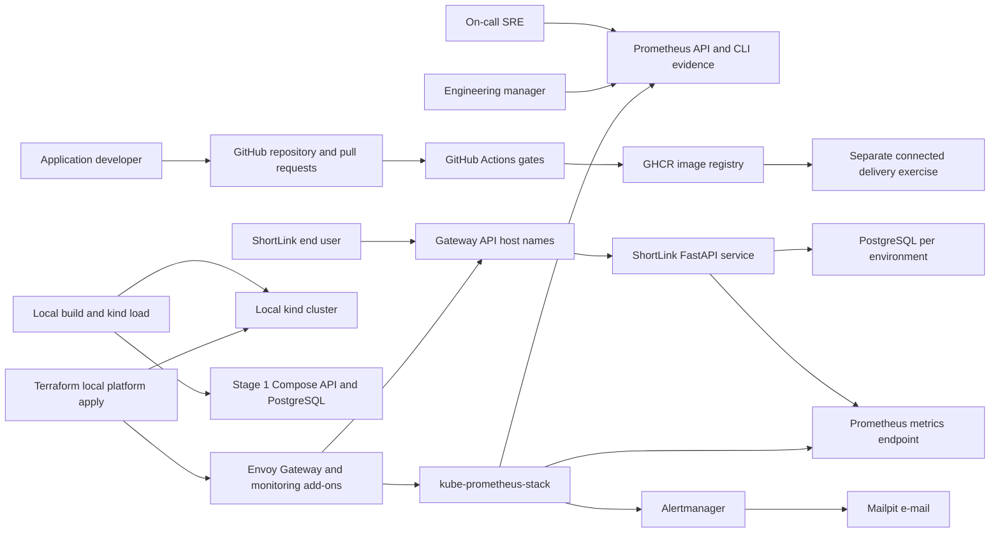
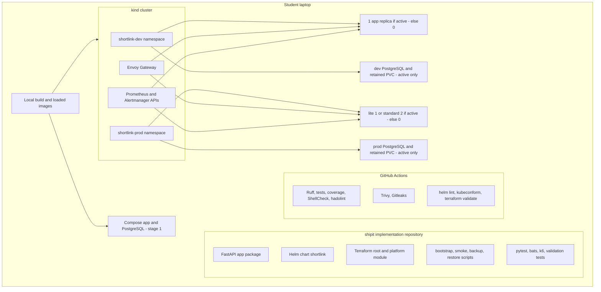
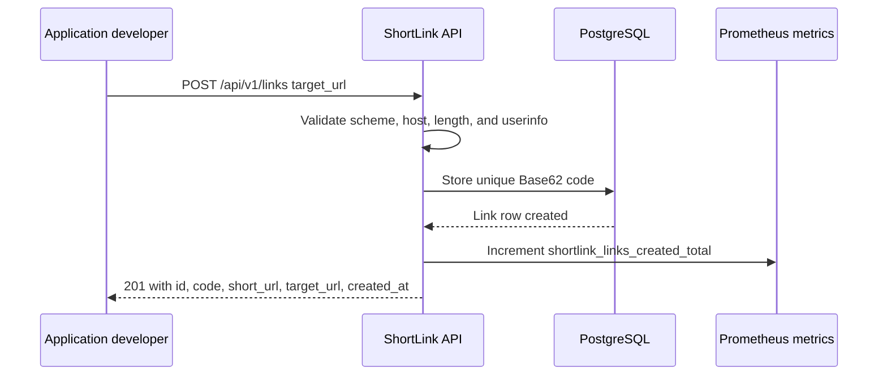
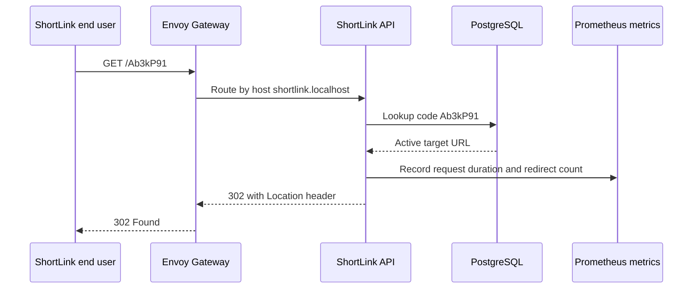
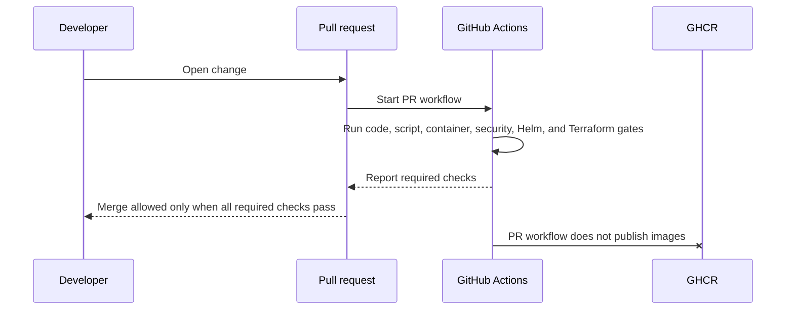
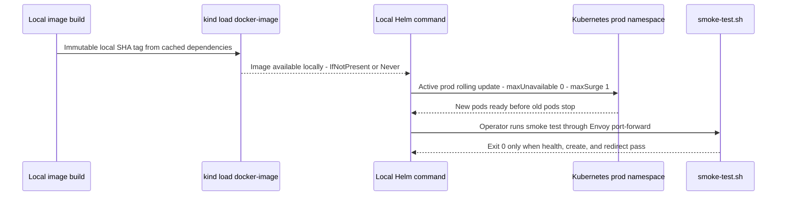
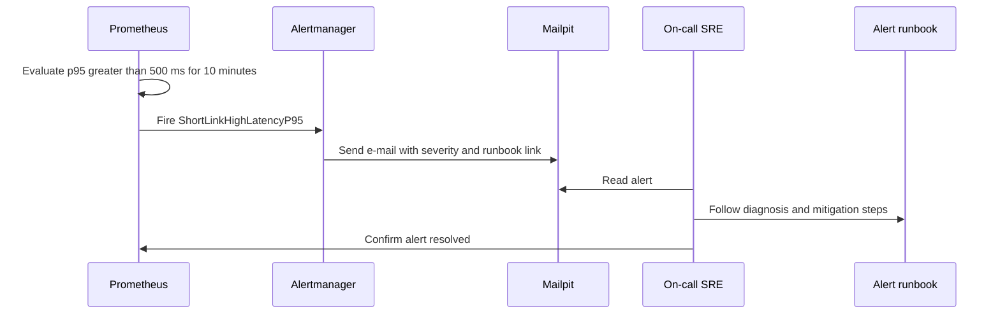

# System architecture

Purpose: This document shows how ShipIt joins the ShortLink API, delivery platform, Kubernetes runtime, and observability tools into one local DevOps training system.

## Architecture goals

ShipIt MUST make a small URL-shortener safe to build, deploy, observe, and recover. The design keeps the app simple. The platform work carries most of the learning value.

## Context diagram



## Container and platform component diagram



Compose comes first and is stopped before kind. Both namespace definitions are retained, but only one app/database environment runs at once. Built-in Grafana may be inspected only as optional standard operations tooling; no frontend/custom dashboard exists. CI/GHCR delivery is independent of the local image path.

## Key runtime flows

### Create short link



### Redirect a user



### Pull request gate



### Local production-profile deployment and smoke test



### Alert and runbook response



## Data-flow description

| Data item | Producer | Consumer | Storage or transport | Protection rule |
|---|---|---|---|---|
| Target URL | API client | ShortLink API and PostgreSQL | Loopback HTTP request and database row | Validate scheme/host/length/userinfo; do not fetch or follow the fictional target in local tests. |
| Short code | ShortLink API | End user and redirect lookup | PostgreSQL unique value and response JSON | Use 7 Base62 characters and stop after maximum 5 total generation attempts. |
| Runtime config | Env files, ConfigMaps, Secrets | App pods and scripts | Environment variables and Kubernetes references | Secrets stay out of Git and image layers. |
| App metrics | ShortLink API | Prometheus HTTP API/CLI evidence | `/metrics` scrape and saved query JSON | Names match BR-07; exclude probes from RED and filter active environment. |
| JSON logs | ShortLink API and scripts | Student and optional Loki | Container logs or Loki in standard profile | Logs never print database passwords or API keys. |
| Images | Local build or connected CI | Local Compose/kind or GHCR exercise | Local image load or separate registry tags | Local SHA tag and permitted pull policy; registry publishing never blocks local startup. |
| Backup files | `db-backup.sh` | `db-restore.sh` and restore drill | Local ignored backup directory | Use timestamp `YYYYMMDD-HHMMSS` and 7-day retention. |
| Alert e-mail | Alertmanager | SRE through Mailpit HTTP API | Internal SMTP and saved message JSON | Service/environment/severity/summary/runbook link; duplicates allowed; built-in console optional operations-only. |

## Local deployment view

| Profile | Hardware | Cluster shape | Platform services | Resource intent | When to use |
|---|---|---|---|---|---|
| Lite | 8 GB RAM, 4 cores, 20 GB disk | Compose then strictly 1-node kind | Envoy, 6-hour Prometheus/Alertmanager, Mailpit; Grafana/Loki/Argo CD off | One active app/database; app 256 MiB + surge reserve 256 MiB; database 512 MiB | Must work and recorded trainer pre-check. |
| Standard | 16 GB RAM, 4 or more cores, 30 GB disk | Compose then 1-node Must; 3-node Should separately budgeted | Same core stack, 24-hour Prometheus; optional add-ons separately checked | Active prod 2 app pods at 512 MiB + 512 MiB surge; one database 1 GiB | Reference 50-VU runs and Should extensions. |

Windows students MUST use WSL2 Ubuntu. The 8 GB profile uses WSL memory 4 GB and swap 4 GB. The 16 GB profile uses WSL memory 8 GB and swap 4 GB.

Document 06 owns [proposed component budgets](06-tech-stack-and-setup.md#hardware-profiles): lite core 2,812 MiB plus 256 MiB surge; standard core 5,532 MiB plus 512 MiB surge, excluding optional add-ons. These are not measured results. Trainer pre-check records startup/steady/load/surge peaks with one active environment, offline image/artifact use, loopback binds, and TC-LOCAL-001 to TC-LOCAL-004. Data persists through the start/stop contract, not by keeping both environments running.

## Kubernetes environment allocation

| Environment | Namespace | Host name | App replicas | Database | Primary purpose |
|---|---|---|---:|---|---|
| dev | `shortlink-dev` | `shortlink-dev.localhost` | 1 | Separate PostgreSQL StatefulSet and PVC | Feature testing and automatic GitOps sync when implemented. |
| prod | `shortlink-prod` | `shortlink.localhost` | Lite 1 / standard 2 | Separate PostgreSQL StatefulSet and PVC | Release demo, alerts, rollback, and profile-appropriate rolling update. |

Replica counts in this table apply only to the active environment; inactive app/database counts are 0. Compose uses 8080, kind Gateway 8081, Prometheus 9090, Alertmanager 9093, Mailpit API 8025, and kind API 6445, all on loopback.

## Expected student repository tree

```text
shipit/
  README.md
  pyproject.toml
  uv.lock
  app/
    shortlink/
      api/
      core/
      db/
      metrics/
      tests/
  deploy/
    helm/shortlink/
      Chart.yaml
      templates/
      values-dev.yaml
      values-prod.yaml
      values-lite.yaml
      values-standard.yaml
      values-local.yaml
    terraform/
      modules/platform/
  scripts/
    bootstrap.sh
    smoke-test.sh
    db-backup.sh
    db-restore.sh
    create-secrets.sh
  Makefile
  compose.yaml
  tests/
    bats/
    k6/
    infra/
  docs/
    adr/
    runbooks/
    evidence/
```

The tree shows expected locations only. This specification does not provide implementation files.

## Design principles

| Principle | ShipIt meaning |
|---|---|
| Local first | Compose first, kind second with loaded local images/cached artifacts; no cloud account or registry dependency. |
| 12-factor configuration | The app reads config from environment variables and separates secrets from code. |
| Small blast radius | Dev and prod have separate namespaces, databases, hosts, and values. |
| Fail before deploy | CI blocks bad changes before images publish or Helm upgrades run. |
| Observe every release | Prometheus/Alertmanager API results, logs, and smoke tests show release health; no custom visualization. |
| Recover by practice | Rollback, pod kill, and backup restore drills produce evidence. |
| Secure by default | Containers run non-root, drop capabilities, and use read-only root filesystems. |
| Explain trade-offs | ADRs record platform choices instead of hiding them in files. |

## ADR topics the student MUST write

| ADR ID | Topic | Exact question the ADR MUST answer | Minimum decision evidence |
|---|---|---|---|
| ADR-001 | Terraform versus OpenTofu | Which IaC tool will ShipIt use for the Must platform, and why is it acceptable for the cohort? | Version line, licence note, and command compatibility risk. |
| ADR-002 | Gateway API implementation | Why does ShipIt use Envoy Gateway instead of ingress-nginx for kind routing? | Maintenance status, Gateway API support, and local fit. |
| ADR-003 | PostgreSQL deployment style | Why is a plain StatefulSet used before any database operator? | Must scope rule, learning value, backup responsibility, and operator trade-off. |
| ADR-004 | Image base and runtime user | Which Python base image and user model keep the final image below 200 MB and non-root? | Image size evidence and user ID strategy. |
| ADR-005 | Secret handling | How will local secret files, Kubernetes Secrets, and ignored paths prevent secret commits? | Ignored file names, creation flow, and Gitleaks evidence. |
| ADR-006 | Optional cache | If caching is implemented, will ShipIt use Valkey or Redis, and what licence reason supports the choice? | Cache TTL 60 seconds and invalidation risk. |
| ADR-007 | Optional log stack | If standard logging is implemented, why use Loki with Alloy and not Promtail? | Version line and deprecation reason. |
| ADR-008 | Production release safety | What settings and checks make local prod rolling updates safe under profile-appropriate k6 load? | Lite 1/standard 2 replicas, maxUnavailable 0/maxSurge 1, memory reserve, probes, loaded rollback tag, and trigger. |

[Back to README](../README.md)
