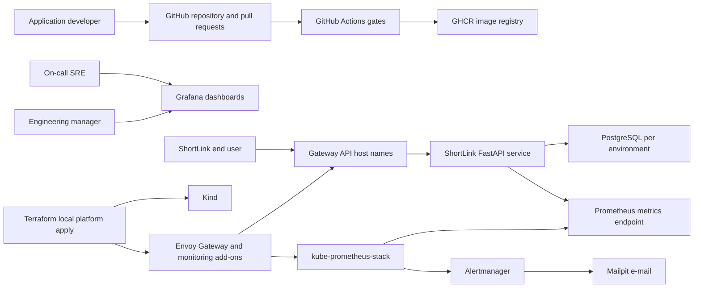
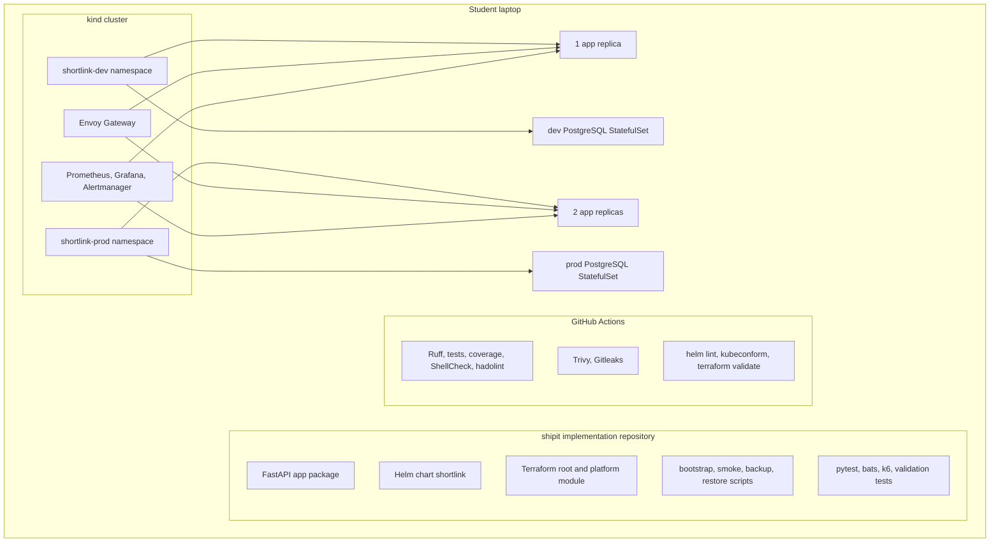
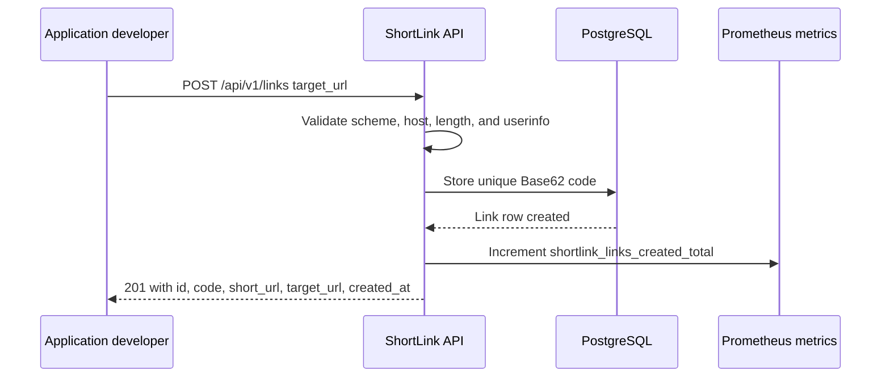
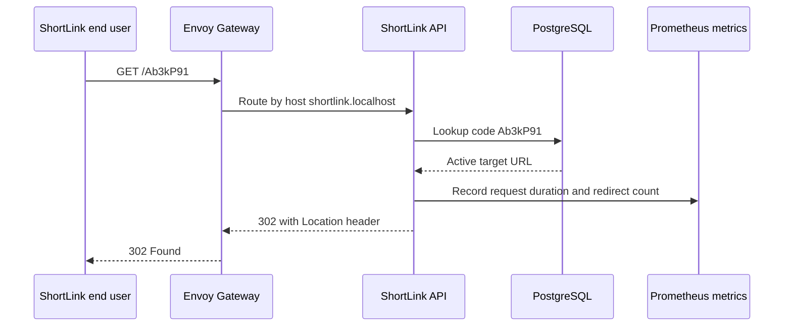
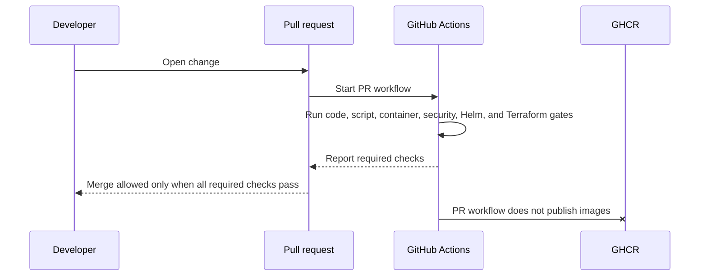
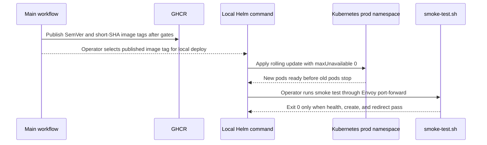
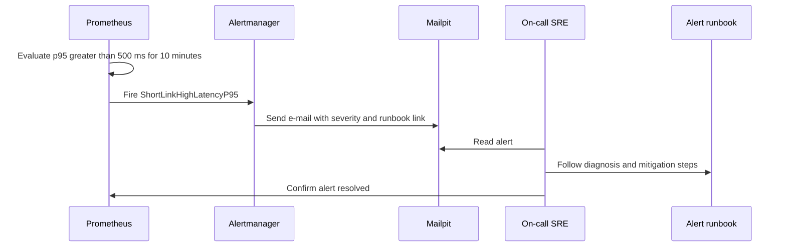

# System architecture

Purpose: This document shows how ShipIt joins the ShortLink API, delivery platform, Kubernetes runtime, and observability tools into one local DevOps training system.

## Architecture goals

ShipIt MUST make a small URL-shortener safe to build, deploy, observe, and recover. The design keeps the app simple. The platform work carries most of the learning value.

## Context diagram



## Container and platform component diagram



## Key runtime flows

### Create short link



### Redirect a user



### Pull request gate



### Production deployment and smoke test



### Alert and runbook response



## Data-flow description

| Data item | Producer | Consumer | Storage or transport | Protection rule |
|---|---|---|---|---|
| Target URL | API client | ShortLink API and PostgreSQL | HTTPS-like local HTTP flow and database row | Validate scheme, host, length, and userinfo before storage. |
| Short code | ShortLink API | End user and redirect lookup | PostgreSQL unique value and response JSON | Use 7 Base62 characters and stop after maximum 5 total generation attempts. |
| Runtime config | Env files, ConfigMaps, Secrets | App pods and scripts | Environment variables and Kubernetes references | Secrets stay out of Git and image layers. |
| App metrics | ShortLink API | Prometheus and Grafana | `/metrics` scrape | Metric names match BR-07 exactly. |
| JSON logs | ShortLink API and scripts | Student and optional Loki | Container logs or Loki in standard profile | Logs never print database passwords or API keys. |
| Images | CI workflow | GHCR and Kubernetes deployments | Registry tags | Use immutable SemVer tags and short SHA tags; prod pins short SHA or digest. |
| Backup files | `db-backup.sh` | `db-restore.sh` and restore drill | Local ignored backup directory | Use timestamp `YYYYMMDD-HHMMSS` and 7-day retention. |
| Alert e-mail | Alertmanager | SRE through Mailpit | Local SMTP and web UI | Message includes service, environment, severity, summary, and runbook link; duplicate messages are allowed. |

## Local deployment view

| Profile | Hardware | Cluster shape | Platform services | Resource intent | When to use |
|---|---|---|---|---|---|
| Lite | 8 GB RAM laptop | 1-node kind | Envoy Gateway, kube-prometheus-stack with 6-hour retention, Mailpit | App limit 256 MiB per pod; PostgreSQL limit 512 MiB per environment | Week 1 to week 4 Must work and trainer pre-check. |
| Standard | 16 GB RAM laptop | 1-node kind for Must; optional 3-node kind for Should | Envoy Gateway, 24-hour Prometheus, optional Loki, Alloy, Argo CD, metrics-server | App limit 512 MiB per pod; PostgreSQL limit 1 GiB per environment | Final demos, k6 performance runs, and Should extensions. |

Windows students MUST use WSL2 Ubuntu. The 8 GB profile uses WSL memory 4 GB and swap 4 GB. The 16 GB profile uses WSL memory 8 GB and swap 4 GB.

| Component | Lite budget | Standard budget |
|---|---:|---:|
| kind node overhead | 700 MiB | 1,200 MiB |
| Envoy Gateway controller and proxy | 192 MiB | 384 MiB |
| Prometheus | 640 MiB | 1,100 MiB |
| Grafana | 192 MiB | 320 MiB |
| Alertmanager | 96 MiB | 160 MiB |
| Prometheus Operator | 192 MiB | 256 MiB |
| kube-state-metrics | 96 MiB | 160 MiB |
| node-exporter | 64 MiB | 96 MiB |
| Mailpit | 64 MiB | 128 MiB |
| ShortLink app pods | 512 MiB total | 1,024 MiB total |
| Two PostgreSQL pods | 768 MiB total | 1,800 MiB total |
| **Steady total** | **3,516 MiB** | **6,628 MiB** |

Trainer pre-check validates these budgets with both environments deployed. Helm install and image-pull peaks MAY use swap briefly, but steady state MUST fit inside WSL memory.

## Kubernetes environment allocation

| Environment | Namespace | Host name | App replicas | Database | Primary purpose |
|---|---|---|---:|---|---|
| dev | `shortlink-dev` | `shortlink-dev.localhost` | 1 | Separate PostgreSQL StatefulSet and PVC | Feature testing and automatic GitOps sync when implemented. |
| prod | `shortlink-prod` | `shortlink.localhost` | 2 | Separate PostgreSQL StatefulSet and PVC | Release demo, alerts, rollback, and zero-downtime drill. |

## Expected student repository tree

```text
shipit/
  README.md
  pyproject.toml
  uv.lock
  app/
    shortlink/
      api/
      core/
      db/
      metrics/
      tests/
  deploy/
    helm/shortlink/
      Chart.yaml
      templates/
      values-dev.yaml
      values-prod.yaml
    terraform/
      modules/platform/
  scripts/
    bootstrap.sh
    smoke-test.sh
    db-backup.sh
    db-restore.sh
    create-secrets.sh
  tests/
    bats/
    k6/
    infra/
  docs/
    adr/
    runbooks/
    evidence/
```

The tree shows expected locations only. This specification does not provide implementation files.

## Design principles

| Principle | ShipIt meaning |
|---|---|
| Local first | Must scope runs on kind, Docker, and local tools without a cloud account. |
| 12-factor configuration | The app reads config from environment variables and separates secrets from code. |
| Small blast radius | Dev and prod have separate namespaces, databases, hosts, and values. |
| Fail before deploy | CI blocks bad changes before images publish or Helm upgrades run. |
| Observe every release | Dashboards, alerts, logs, and smoke tests show release health. |
| Recover by practice | Rollback, pod kill, and backup restore drills produce evidence. |
| Secure by default | Containers run non-root, drop capabilities, and use read-only root filesystems. |
| Explain trade-offs | ADRs record platform choices instead of hiding them in files. |

## ADR topics the student MUST write

| ADR ID | Topic | Exact question the ADR MUST answer | Minimum decision evidence |
|---|---|---|---|
| ADR-001 | Terraform versus OpenTofu | Which IaC tool will ShipIt use for the Must platform, and why is it acceptable for the cohort? | Version line, licence note, and command compatibility risk. |
| ADR-002 | Gateway API implementation | Why does ShipIt use Envoy Gateway instead of ingress-nginx for kind routing? | Maintenance status, Gateway API support, and local fit. |
| ADR-003 | PostgreSQL deployment style | Why is a plain StatefulSet used before any database operator? | Must scope rule, learning value, backup responsibility, and operator trade-off. |
| ADR-004 | Image base and runtime user | Which Python base image and user model keep the final image below 200 MB and non-root? | Image size evidence and user ID strategy. |
| ADR-005 | Secret handling | How will local secret files, Kubernetes Secrets, and ignored paths prevent secret commits? | Ignored file names, creation flow, and Gitleaks evidence. |
| ADR-006 | Optional cache | If caching is implemented, will ShipIt use Valkey or Redis, and what licence reason supports the choice? | Cache TTL 60 seconds and invalidation risk. |
| ADR-007 | Optional log stack | If standard logging is implemented, why use Loki with Alloy and not Promtail? | Version line and deprecation reason. |
| ADR-008 | Production release safety | What settings and checks make prod rolling updates safe under k6 load? | Replica count, maxUnavailable 0, probes, and rollback trigger. |

[Back to README](../README.md)
