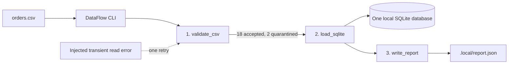

# 05 — System architecture

## Architecture and fixed task flow

The runner is one local process. Tasks run sequentially and are fixed by the specification; the database, input, and report are ordinary local files.

## Data flow

| Order | Action | Result |
|---:|---|---|
| 1 | Read source bytes, compute SHA-256, derive the run ID from checksum and business date. | Stable logical run identity |
| 2 | Validate the CSV header and rows. Retry one test-injected transient read failure once. | Accepted rows plus quarantined rows with reason codes |
| 3 | Persist run/task state and both row groups in SQLite in a transaction. | Per-run counts: 18 accepted and 2 quarantined for the fixture |
| 4 | Write the single deterministic JSON report. | Three successful task records and matching counts |

If task 1 or 2 fails, later tasks are marked skipped. Row-level invalids are quarantined and do not stop the flow.

## Decisions

1. **Why a stable run ID?** Use business date plus a prefix of the source SHA-256 so the same logical input can be safely replayed and inspected.
2. **Where do rejected rows go?** Store them in a quarantine table in the same SQLite file, avoiding a second persistence format.
3. **What is fatal?** Invalid rows are quarantined; unreadable input, invalid header/date, and task errors stop the affected task and downstream work.

[Back to README](../README.md)
