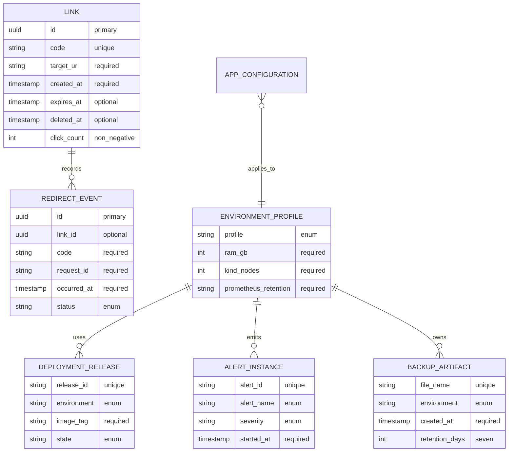

# Data model

Purpose: This document defines ShortLink data, platform evidence records, relationships, constraints, sample data, retention, and migration policy.

## Data scope

ShipIt uses PostgreSQL for ShortLink application data. Each Kubernetes environment has its own PostgreSQL StatefulSet, PVC, and Service. Dev and prod data MUST NOT share a database. Platform evidence such as backups, releases, and alerts can be stored as repository documents or database rows in the student implementation.

## Entities and tables

### Link

| Column | Logical type | Constraints | Description |
|---|---|---|---|
| `id` | uuid | Primary identifier; generated by the app. | Internal link ID. |
| `code` | string | Unique; generated length 7; custom alias 3-32 chars when Should feature is used. | Public short code in `GET /{code}`. |
| `target_url` | string | Required; maximum 2048 chars; `http` or `https`; host required; no username or password. | Destination URL. |
| `created_at` | timestamp | Required; stored in UTC; displayed with local offset in docs. | Creation time. |
| `expires_at` | timestamp | Nullable; must be future when supplied. | Optional expiry time. |
| `deleted_at` | timestamp | Nullable. | Soft-delete marker for optional delete feature. |
| `click_count` | int | Required; default 0; never negative. | Redirect count for optional stats and simple demos. |
| `created_by` | string | Nullable; maximum 80 chars. | Fictional label or API key label. |

### Redirect event

| Column | Logical type | Constraints | Description |
|---|---|---|---|
| `id` | uuid | Primary identifier. | Redirect event ID. |
| `link_id` | uuid | References Link when the code exists; nullable for missing-code events. | Link that was requested. |
| `code` | string | Required; stores the requested code. | Supports analysis of missing or expired codes. |
| `request_id` | string | Required; maximum 80 chars. | Correlates log, metric, and event. |
| `occurred_at` | timestamp | Required; stored in UTC. | Time of redirect attempt. |
| `status` | enum | One of redirect event status values. | Redirect result. |
| `user_agent_hash` | string | Nullable; maximum 128 chars. | Low-detail diagnostic value; never raw personal data. |

### App configuration

| Column | Logical type | Constraints | Description |
|---|---|---|---|
| `name` | string | Unique within environment. | Configuration key name. |
| `value_source` | enum | ConfigMap, Secret, or environment. | Where the runtime value comes from. |
| `required` | boolean | Required flag. | Startup fails if a required value is missing. |
| `environment` | enum | `dev` or `prod`. | Target environment. |
| `description` | string | Required. | Plain-English purpose. |

### Deployment release

| Column | Logical type | Constraints | Description |
|---|---|---|---|
| `release_id` | string | Unique; matches Helm release revision or Git tag. | Release evidence identifier. |
| `environment` | enum | `dev` or `prod`. | Deployment target. |
| `image_tag` | string | Required; SemVer or short SHA. | Container image tag. |
| `state` | enum | Release state values. | Current release status. |
| `deployed_at` | timestamp | Nullable until deployed. | Deployment time. |
| `rollback_from` | string | Nullable. | Previous failed release when rollback occurs. |

### Alert instance

| Column | Logical type | Constraints | Description |
|---|---|---|---|
| `alert_id` | string | Unique per firing alert. | Alertmanager or evidence identifier. |
| `alert_name` | enum | Mandatory alert name. | Alert type. |
| `environment` | enum | `dev` or `prod`. | Affected environment. |
| `severity` | enum | `warning` or `critical`. | Alert severity. |
| `started_at` | timestamp | Required. | First firing time. |
| `resolved_at` | timestamp | Nullable. | Resolution time. |
| `runbook` | string | Required. | Relative link to the runbook. |

### Backup artifact

| Column | Logical type | Constraints | Description |
|---|---|---|---|
| `file_name` | string | Unique; includes timestamp `YYYYMMDD-HHMMSS`. | Local backup file name. |
| `environment` | enum | `dev` or `prod`. | Source database environment. |
| `created_at` | timestamp | Required. | Backup creation time. |
| `source_database` | string | Required. | Database name. |
| `retention_days` | int | Always 7 for Must scope. | Rotation period. |
| `restore_tested_at` | timestamp | Nullable. | Most recent restore drill time. |

### Environment profile

| Column | Logical type | Constraints | Description |
|---|---|---|---|
| `profile` | enum | `lite` or `standard`. | Hardware profile. |
| `ram_gb` | int | 8 for lite; 16 for standard. | Expected host RAM. |
| `kind_nodes` | int | 1 for lite; 1 Must or 3 Should for standard. | kind node count. |
| `prometheus_retention` | string | `6h` or `24h`. | Local metric retention. |
| `loki_enabled` | boolean | False in lite. | Whether log stack runs. |
| `argocd_enabled` | boolean | False in lite. | Whether GitOps stack runs. |

## Relationships



## Required indexes and constraints

These are requirements, not SQL DDL.

| Name | Type | Requirement |
|---|---|---|
| `link_code_unique` | Unique index | Link `code` MUST be unique in each environment database. |
| `link_created_at_index` | Index | Link `created_at` SHOULD support recent-link checks and demos. |
| `link_expiry_index` | Index | Link `expires_at` SHOULD support expiry queries when optional expiry is implemented. |
| `redirect_link_time_index` | Index | Redirect event `link_id` and `occurred_at` SHOULD support stats endpoint queries. |
| `redirect_code_time_index` | Index | Redirect event `code` and `occurred_at` SHOULD support missing-code diagnostics. |
| `target_url_validation` | Check or application validation | `target_url` MUST follow BR-02. |
| `click_count_non_negative` | Check or application validation | `click_count` MUST be zero or greater. |
| `backup_file_unique` | Unique constraint | Backup evidence MUST NOT contain two records for the same file. |
| `release_environment_state_index` | Index | Release evidence SHOULD be queryable by environment and state. |

## Enumerations

| Enum | Values |
|---|---|
| Environment | `dev`, `prod` |
| Kubernetes namespace | `shortlink-dev`, `shortlink-prod` |
| Host base URL | `http://shortlink-dev.localhost:8080`, `http://shortlink.localhost:8080` |
| Redirect event status | `redirected`, `not_found`, `expired`, `deleted` |
| Release state | `proposed`, `tested`, `published`, `deployed_dev`, `deployed_prod`, `rolled_back`, `verified` |
| Alert name | `ShortLinkHighErrorRate`, `ShortLinkHighLatencyP95`, `ShortLinkPodCrashLooping`, `ShortLinkTargetDown` |
| Alert severity | `warning`, `critical` |
| Value source | `ConfigMap`, `Secret`, `environment` |
| Profile | `lite`, `standard` |

## Sample data

### Link rows

| `code` | `target_url` | `created_at` | `expires_at` | `click_count` |
|---|---|---|---|---:|
| `Ab3kP91` | `https://example.in/careers` | `2026-10-02T04:30:00Z` | Not set | 12 |
| `team-ops` | `https://example.com/docs/shipit` | `2026-10-02T05:00:00Z` | `2026-12-31T18:29:00Z` | 4 |
| `old2026` | `https://example.in/events/devops` | `2026-09-01T03:30:00Z` | `2026-10-01T18:30:00Z` | 8 |

### API request and response example

Request body:

```json
{
  "target_url": "https://example.in/careers"
}
```

Successful response body:

```json
{
  "id": "11111111-2222-4333-8444-555555555555",
  "code": "Ab3kP91",
  "short_url": "http://shortlink.localhost:8080/Ab3kP91",
  "target_url": "https://example.in/careers",
  "created_at": "2026-10-02T10:00:00+05:30"
}
```

### Backup artifact evidence

| `file_name` | `environment` | `source_database` | `retention_days` |
|---|---|---|---:|
| `shortlink-prod-20261002-103000.dump` | `prod` | `shortlink_prod` | 7 |
| `shortlink-dev-20261002-110000.dump` | `dev` | `shortlink_dev` | 7 |

## Data retention

| Data | Retention requirement |
|---|---|
| Link rows | MAY stay forever unless deleted by the optional delete feature. |
| Redirect events | SHOULD be kept for 30 days in the local project. |
| Application logs in lite profile | SHOULD be kept only in container logs during the session. |
| Loki logs in standard profile | SHOULD be kept for 24 hours. |
| Prometheus metrics in lite profile | MUST use 6-hour retention. |
| Prometheus metrics in standard profile | SHOULD use 24-hour retention. |
| Database backups | MUST rotate after 7 days. |
| Reliability evidence | MUST remain in the student repository until final evaluation. |

## Migration policy

- The student MUST use a migration tool or a clearly documented migration command.
- A schema change MUST include a migration review note in the pull request.
- A schema change that changes a business rule MUST include or update an ADR.
- A migration MUST be reversible when practical.
- A migration MUST have a test or demo step before production values are updated.
- Dev migrations MUST run before prod migrations.
- Migration logs MUST NOT print database passwords.

## Data quality requirements

| Check | Requirement |
|---|---|
| URL validity | Invalid scheme, missing host, over 2048 chars, or username/password in URL is rejected. |
| Code uniqueness | Duplicate code creation stops after maximum 5 total generation attempts. |
| Timestamp consistency | Stored timestamps use UTC; documentation examples MAY show `+05:30`. |
| Environment isolation | Dev links never appear in prod database and prod links never appear in dev database. |
| Backup restore | Restored database contains the expected sample code and row count from the selected backup. |

[Back to README](../README.md)
