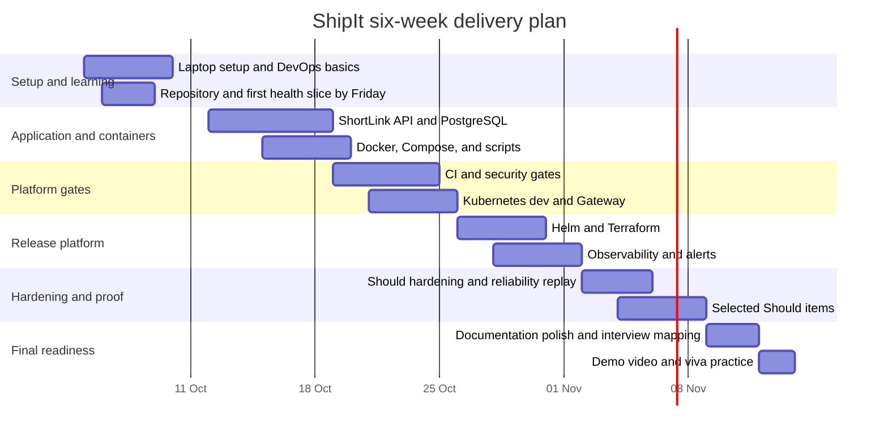

# Milestones and deliverables

Purpose: This document gives the ShipIt effort budget, six-week plan, deliverables, submission process, and final demo script.

## Effort budget

The total project budget is about 180 hours. Must work is about 120 hours, including about 30 hours of learning and setup.

Version 1.1 keeps six weeks and this budget. Dashboard-authoring effort moves to PromQL/API evidence and rule tests within observability; cloud-demo contingency moves to local artifact/rollback validation. Local start/stop, migrations/seed, caches, memory profiling, and acceptance are inside the existing setup/container/platform allocations, not extra frontend work or weeks.

| Feature area | Linked IDs | Must hours | Should or contingency hours | Notes |
|---|---|---:|---:|---|
| Guided learning and local setup | FR-LOCAL-01, NFR-PORT-01, NFR-HW-01 | 30 | 0 | Cache/tool/secret preparation and consistent WSL recommendations count inside Must; proposed budgets require pre-check. |
| ShortLink app and database | FR-APP-01 to FR-APP-04 | 16 | 6 | Should time covers alias, expiry, stats, delete, and cache. |
| Containers, Compose, and scripts | FR-CON-01, FR-CON-02, FR-BASH-01, FR-LOCAL-01 | 11 | 4 | Compose first, seed/migrations, start/stop/persistence/failures, backup/restore. |
| GitHub Actions and security gates | FR-CI-01 to FR-CI-03, FR-SEC-01, FR-SEC-02 | 12 | 5 | Should time covers release workflow, SBOM, and extra lint. |
| Kubernetes and Gateway | FR-K8S-01 to FR-K8S-06 | 14 | 8 | Should time covers HPA, PDB, NetworkPolicy, and multi-node kind. |
| Helm and Terraform | FR-HELM-01, FR-HELM-02, FR-IAC-01, FR-IAC-02 | 11 | 6 | Should time covers helm-unittest, TFLint, and Terraform tests. |
| Observability, alerting, and runbooks | FR-OBS-01 to FR-OBS-04, FR-REL-01 | 10 | 8 | Must: saved API/CLI metric/alert evidence and rule tests. Should: Loki/Alloy API evidence, SLO queries/burn alerts. No visualization authoring. |
| Reliability drills and evidence | FR-REL-02 | 6 | 5 | Must evidence is complete by the end of week 4. |
| Documentation, interview, and final polish | FR-DOC-01, FR-LOCAL-01, FR-LOCAL-02 | 10 | 18 | README local contract and AWS interview theory are Must; optional artifact checks replace cloud-demo contingency. |
| **Total** |  | **120** | **60** | Could items start only after all Must items pass. |

## Week-by-week plan

| Week | Goals | Tasks that name FR IDs | Deliverables | Friday demo checkpoint |
|---|---|---|---|---|
| 1 | Prepare laptop and backend thin slice. | Set up WSL2/local tools and caches, FR-LOCAL-01 entrypoint contracts, GitHub Flow, FR-APP-03 health, and ADR/mapping drafts. | Setup/secret/cache checklist, first health slice and CI skeleton; recorded trainer proposed/observed resource pre-check. | Show prerequisite/port checks and explain local versus connected CI. |
| 2 | Complete Compose first runnable stage. | Complete FR-APP-01/02/04, FR-CON-01/02, FR-BASH-01, and stage 1 FR-LOCAL-01 acceptance. | API/tests, local image, healthy Compose app/PostgreSQL, migrations/fictional seed, named-volume persistence, JSON logs, all four Compose local cases. | Run local start/demo/stop/restart with no egress after preparation; show exact seed redirect and preserved code. |
| 3 | Add CI gates and local Kubernetes dev. | Complete FR-CI-01/02/03 and FR-K8S-01/02/03/04; build/load local image independently of GHCR; add scans and isolated CI acceptance. | PR gates and separate GHCR tag evidence; one-node dev kind, cached add-ons/providers/charts, loopback route, ignored Secret files, local pull policy. | Show dev health at loopback 8081 with Host header and no registry dependency; show a deliberately failed coverage gate. |
| 4 | Finish local prod and Must observability. | Complete remaining Kubernetes/Helm/Terraform, FR-OBS-01 to FR-OBS-04, FR-REL-01/02, FR-SEC-02, FR-DOC-01, and both-stage FR-LOCAL-01 acceptance. | Sequential dev/prod definitions, active prod lite 1/standard 2, saved Prometheus/alert JSON, runbooks/drills, all four kind local cases, interview theory. | Show profile replicas, inactive workloads 0, metric/alert API evidence, Mailpit message, offline rollout/rollback, and persistent restart. |
| 5 | Add selected Should items and harden evidence. | Choose from FR-GITOPS-01, FR-LOG-01, FR-SCALE-01, FR-K8S-07, FR-NET-01, FR-TEST-01, FR-JENKINS-01. | Rolling update evidence, rollback evidence, pod kill evidence, optional hardening PRs. | Run k6 during a prod update and show 0 failed requests. Explain GitHub Actions versus Jenkins. |
| 6 | Final polish, demo, and interview readiness. | Close test gaps, update ADRs, polish README, prepare viva for all Must IDs. | Final repository, coverage report, ADRs, runbooks, screenshots or logs, 5-minute demo video, submission issue. | Run the full 10-minute final demo script and answer viva questions. |

## Gantt chart

## Final deliverables checklist

| Deliverable | Required evidence |
|---|---|
| Public `shipit` repository | Trainer `@sukurcf` is a collaborator. |
| Student README | Document 06 contract in 10 steps or fewer: Compose then kind, start/stop/demo, ignored secrets, prepared caches, seed/migrations, loopback ports, persistence, confirmed reset, failures, hardware/WSL guidance. |
| Architecture diagram | Shows backend API, independent persistent databases, Compose/local image path, kind, Envoy, Prometheus/Alertmanager APIs, Mailpit; GHCR is a separate CI path. |
| ADRs | At least 5 ADRs covering Terraform/OpenTofu, Gateway, PostgreSQL design, secret handling, and optional cache or logs. |
| Test and coverage report | At least 45 meaningful cases; 80% line/70% branch; TC-LOCAL-001 to TC-LOCAL-004 pass for both stages with saved offline/persistence/failure evidence. |
| CI evidence | Required checks on `main` are green. |
| Security evidence | Gitleaks clean, Trivy clean by policy, no secrets in history. |
| Helm evidence | Both profiles/active-inactive values render; prod lite 1/standard 2; maxUnavailable 0/maxSurge 1; loaded local tags permitted; active `helm test` passes. |
| Terraform evidence | Cached offline apply/resume shows cluster, hosts, Gateway 8081, Prometheus 9090, Alertmanager 9093; kind API is loopback 6445. |
| Monitoring evidence | Saved Prometheus API/CLI responses prove rate, 5xx, p50/p95/p99, CPU, memory, and restarts, with queries/units/time/environment. |
| Alert evidence | Prometheus/Alertmanager/Mailpit API JSON proves at least 1 matching e-mail and runbook link; no mandatory console demo. |
| Reliability evidence | Rolling update has 0 failed requests; rollback names revision; pod kill recovers within 120 seconds. |
| Demo video | Maximum 5 minutes, focused on working system evidence. |

## Submission process

1. Freeze feature work after all Must gates pass.
2. Open a final submission issue in the specification repository with the `shipit` repository link.
3. Add links to the final PR list, CI run, coverage report, demo video, runbooks, and ADRs.
4. Confirm that no real secret or personal data is in Git history.
5. Attach both-stage local acceptance and trainer resource evidence; no frontend or cloud deployment/bonus claim is accepted.
6. Ask the trainer to schedule the final viva.

## Ten-minute demo script

| Minute | What to show | Evidence to mention |
|---:|---|---|
| 0 | State the problem and architecture in one sentence. | Manual `scp` changed into a local delivery platform. |
| 1 | Show saved CI evidence, then `make local-start` for Compose with prepared caches and no external egress. | Health/ready, stage 1 app/PostgreSQL; no GitHub access needed during demo. |
| 2 | Create a ShortLink for `https://example.in/careers`. | 201 response with 7-character code and JSON log. |
| 3 | Run `make local-demo STAGE=compose`, then stop/restart. | Exact seed 302/Location and missing 404; stored code survives; no redirect following. |
| 4 | Show Docker image evidence. | Image below 200 MB, non-root, no CRITICAL Trivy findings. |
| 5 | Stop Compose; resume prepared kind with `make local-start STAGE=kind PROFILE=lite ENV=prod`. | One node, loaded local tag, both definitions, only prod active at 1 replica (standard 2). |
| 6 | Show Helm and Terraform evidence. | Chart version, release revision, and Terraform outputs. |
| 7 | Query Prometheus/Alertmanager and Mailpit APIs. | Saved RED/resource/alert JSON, units, timestamps, runbook link; no custom visualization. |
| 8 | Show profile-appropriate rollout/rollback evidence and kind stop/restart. | Surge 1, k6 0 failed requests, persisted data; TC-LOCAL-001 to TC-LOCAL-004. |
| 9 | Explain AWS mapping and answer one trade-off. | kind to EKS, GHCR to ECR, PVC to EBS, Gateway to load balancer, Alertmanager e-mail to SNS or SES, local state to S3. |
| 10 | End with next improvements. | One Should item and one Could item with risks. |

[Back to README](../README.md)
